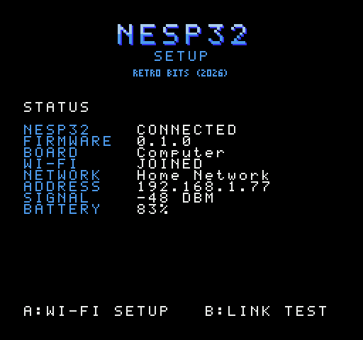
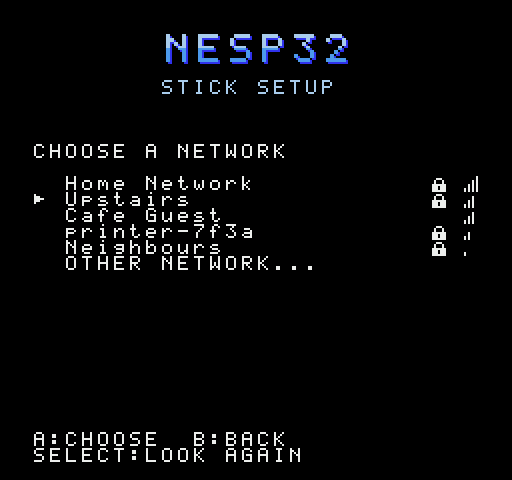
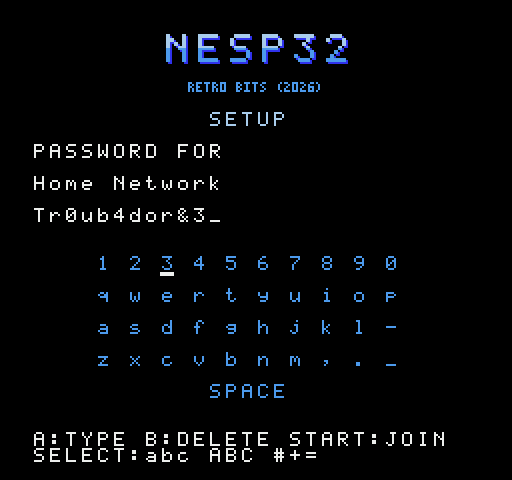
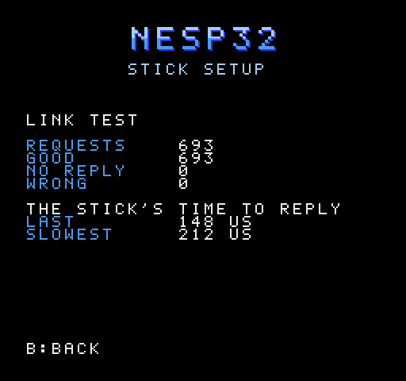

# nesp32

One firmware for an M5Stack Stick on NES controller port 2, to serve every
application that uses one: fetching from the Internet, streaming sound,
two consoles playing one game. A ROM says which services it needs and the
Stick provides them; nothing is chosen on the Stick, and nothing about a
Stick is ever set up from a computer.

It is replacing the separate firmware and link protocol that each of
[nes-radar](../nes-radar), [nes-jukebox](../nes-jukebox),
[nes-wiki](../nes-wiki) and [nes-drmario](../nes-drmario) has, on the hat
and the wiring they share. NESpedia has moved to it; the others have not
yet.

 
 

## Status

Work in progress. **The setup ROM works on hardware:** a StickS3 on the
MiSTer's NES core, through a SNAC adapter. It found the Stick, joined a
Wi-Fi network from the controller, and the Stick joined it again by itself
after a power cycle. The link test ran 6000 requests with every one good,
and the Stick's slowest reply was 215 microseconds
([`firmware/README.md`](firmware/README.md), "On hardware"). A real NES has
not been tried.

| Part | State |
|---|---|
| The protocol ([`docs/PROTOCOL.md`](docs/PROTOCOL.md)) | version 1: frames, hello, and the services SYS, NET (Wi-Fi) and DIAG |
| The link and services in C (`firmware/components/`) | done; tested on a computer |
| The console's library (`nes/lib/`) | done; every read and write timed on py65 |
| The setup ROM (`nes/setup/`): status, Wi-Fi from the controller, link test | done; tested on a simulated console against the C code over a cycle-exact line |
| The Stick's firmware (`firmware/main/`): UART, Wi-Fi, screen | working on a StickS3 with the MiSTer; builds for the StickC Plus2, not run on one |
| A computer in place of a Stick (`host/serial_host.py`) | written, not run on a cable |
| WIKI, NESpedia's service: an HTTPS fetch, the text laid out in lines | working on a StickS3 with the NESpedia ROM ([nes-wiki](../nes-wiki)) |
| Services for the jukebox, netplay and the radar | numbers reserved; not started |

NESpedia runs on it: a search typed on the console is fetched over HTTPS
and read, with the link answering throughout. Next is the second
application.

## Building

Needs [cc65](https://cc65.github.io/) (`ca65`, `ld65`), a C compiler and
Python 3.

```sh
python3 -m venv .venv && .venv/bin/pip install -r requirements-dev.txt
make            # build/setup.nes, and the firmware's code for this computer
make test       # about two and a half minutes
tools/preview.py docs    # the pictures above, from the ROM itself
```

`build/setup.nes` is NROM-256 (mapper 0). The Stick's firmware is built
with ESP-IDF, from `firmware/`.

## The setup ROM

A Stick has no keyboard. This ROM is its setup: plug the Stick into
controller port 2, run the ROM, and use controller 1.

| Screen | Buttons |
|---|---|
| Status: the Stick, its firmware, its Wi-Fi, address, signal, battery | A: Wi-Fi setup. B: link test |
| Networks, strongest first, with a lock on those that want a password | Up, Down. A: choose. Select: look again. B: back |
| Keyboard, for a password (or the name of a network that hides it) | D-pad. A: type. B: delete. Select: `abc`, `ABC`, `#+=`. Start: join |
| Link test: a checked request every frame, and the Stick's time to reply | B: back |

Every printable character can be typed, and a password may be the full 63.
The Stick saves the network and joins it by itself from then on. The
password goes to the Stick and is never sent back.

## How it works

- **The console asks, the Stick answers.** Every exchange is one request
  and one reply, at 85227 baud, bit-banged by counting CPU cycles. A
  request names a service and an op. A request sent again gets the same
  reply again and is not acted on twice.
- **A ROM begins with a hello** that names the services it needs. The
  Stick starts those and stops the rest, so one firmware serves whatever
  cartridge is in.
- **The Stick never keeps the console waiting.** One task on a core of its
  own answers from what the services hold; joining a network, scanning and
  fetching are done by other tasks and asked after.
- **The same C runs on the Stick and under the tests.** The link and the
  services touch no hardware. Built for a computer, they answer the real
  ROM on a simulated console, over a line that models every bit.

## What is where

| Path | Purpose |
|---|---|
| `proto/nesp.toml`, `tools/gen_proto.py` | the numbers both ends share, and the C, ca65 and Python files written from them |
| `docs/PROTOCOL.md` | the protocol |
| `firmware/components/nesp_core` | frames, CRC, services' registry |
| `firmware/components/nesp_services` | SYS, NET, DIAG, WIKI, and the text code WIKI lays articles out with |
| `firmware/main` | the Stick: UART and link task, Wi-Fi, HTTPS fetches, screen and buttons |
| `nes/lib/nesp.inc`, `nes/lib/gen_link.py` | the console's library, and its cycle-timed serial routines |
| `nes/setup/` | the setup ROM |
| `host/nesp_host.c`, `host/nesp.py` | the firmware's code as a library for this computer, with a stand-in for the hardware |
| `host/serial_host.py` | that, on a USB serial cable in place of a Stick |
| `tests/console.py`, `tests/wire.py`, `tests/drive.py` | a console on py65, the serial line, and a hand on the controller |

## Tests

```sh
make test
```

- `test_core.py`: the C link and services, bytes in and bytes out.
- `test_link_timing.py`: every sample and every bit of the console's two
  receivers and its sender, at every phase and with the Stick's clock out.
- `test_link.py`: the ROM and the C code over the line: how soon and how
  late the Stick may answer, damaged and lost frames, a Stick switched off
  and on.
- `test_text.py`, `test_wiki.py`: an API reply to ASCII to lines of 28, and
  the WIKI service with the test in place of the Internet.
- `test_setup.py`: every screen of the setup ROM worked with the
  controller, to a network joined with a password of every character.

The ROM tests need cc65 and skip without it.

## Not done

- A real NES, a long run, and the StickC Plus2.
- The services the jukebox, netplay and the radar need, and their ROMs
  moved to them. NESpedia's is done.
- A fetch that drops partway is not made again; what came is read, if it
  was a screenful.
- Updates over Wi-Fi, and a way to put music on a Stick without a cable.
- PAL consoles.
- A licence. A line-by-line comparison found no code of nes-radar's
  (GPL-3.0) here beyond idioms; the rest descends from nes-jukebox, nes-wiki
  and nes-drmario, which have none yet. The CRC routine without a table
  follows Greg Cook's on 6502.org, whose terms have not been checked.
