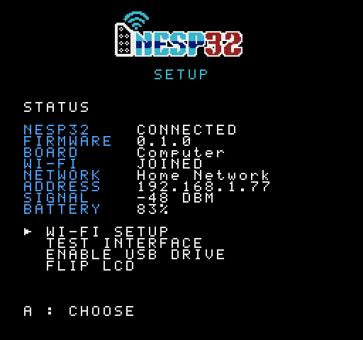
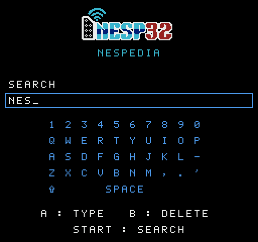
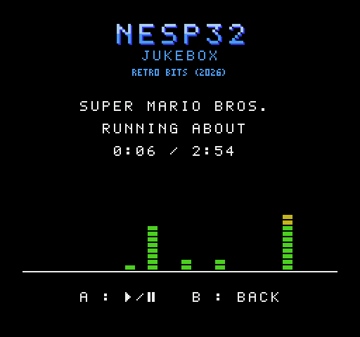
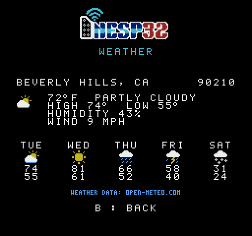
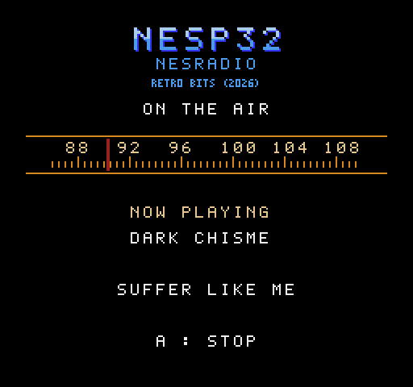

# NESP32

An inexpensive, DIY wireless network interface for the Nintendo Entertainment System (NES) based on
the ESP32 microcontroller. 

<p float="left">
  
  
  
</p>
<p float="left">
  
  
  
</p>

## About

- Provides Internet access, media streaming, and online gaming capabilities to NES software.

- Built using the M5 StickS3, a ~$20 all-in-one IoT development kit that includes a dual core processor, flash storage, audio, WiFi, color LCD screen, battery, USB interface, and buttons. The M5 StickC-Plus2 is also fully supported.

- A custom hat plugs into the top of the device and connects to controller port 2 of the NES. 

- Extensible firmware provides an API that any cartridge-based software can interface with. A setup program allows the wifi and USB storage 
to be configured from the NES itself. 

- The NESP32 grew out of [NES Radar](https://github.com/k6lcm/nes-radar) and [connectedNES](https://github.com/hxlnt/connectedNES), projects that first explored the use of the NES controller port as a data link.

- This project is still just a proof of concept but with your help it could someday become a real boy!

## Quick Links

- [NESP32 Home Page](https://nesp32.retrobits.tv/)

- [Purchase the M5 StickS3](https://amzn.to/3TVUV0y)

- [PCB Gerber Files](hardware/)

- [Online Firmware Installer](https://nesp32.retrobits.tv/flash/)

## NESP32 needs YOU

Interested in trying out or even developing for the NESP32? We'd love to grow a community around this project.

Please join our [Discord](https://discord.gg/kwSC7pwtmb)!

## Demonstration Apps

| Name | Description |
|---|---|
| [Setup](apps/setup) | Configure the NESP32, status, Wi-Fi, link test, USB drive |
| [NESpedia](apps/wiki) | Search and display Wikipedia articles |
| [Jukebox](apps/jukebox) | Stream VGM/VGZ music files and PCM audio to the NES sound chip |
| [Throughput](apps/throughput) | Test the bandwidth of the NES<>ESP32 interface |
| [Dr. Mario 2P](apps/drmario)* | Dr. Mario online two-player |
| [Contra, 2P](apps/contra)* | Contra's online two-player |
| [Tetris 2P](apps/tetris)* | Tetris online two-player |
| [NES Radar](apps/nes-radar) | [k6lcm](https://github.com/k6lcm)'s live air traffic scope, no PC required |
| [National Public Radio](apps/npr) | NPR's live .mp3 radio stream with optional headline news |
| [Weather](apps/weather) | Current conditions and a 5-day forecast for a US zip code, which the NESP32 remembers |

\* These games contain copyrighted material. You must build the ROM yourself using the publicly available disassembly and the NESP32 patch provided here.

## How it works

- **Repurposes controller port 2 for serial I/O.** The console sends data to the NESP32 on the
  shift register strobe line and receives on a data line of port 2. The custom hat shifts the levels between the
  console's 5 V and the NESP32's 3.3 V ([wiring](docs/WIRING.md)).
- **The NES asks, the NESP32 answers.** Every exchange is one request
  and one reply, each with a check. A request names an API service and an operation.
- **A ROM sends a hello** that names the services it needs. Unified firmware serves all supported
  cartridge programs.

## Building

You will need [cc65](https://cc65.github.io/) (`ca65`, `ld65`), a C compiler, `make`, `patch`,
Python 3, and for the firmware [ESP-IDF 5.x](https://docs.espressif.com/projects/esp-idf/en/stable/esp32s3/get-started/)
installed in `~/esp/esp-idf` (or wherever `IDF_PATH` points).

**1. Clone the repository and its submodules**

```sh
git clone --recurse-submodules https://github.com/Armitage64/nesp32.git
cd nesp32
```

If you cloned without the submodules, run `git submodule update --init`.

**2. Build and flash the firmware**

Connect the StickS3 (or StickC-Plus2) over USB, then:

```sh
firmware/deploy.sh          # build, and flash every NESP32 that is connected
```

`firmware/deploy.sh build` builds without flashing, and [firmware/README.md](firmware/README.md)
has the `idf.py` commands it runs. Flashing replaces whatever is on the device. To skip the
build, a released image can be flashed from a browser at [Firmware Updates](https://nesp32.retrobits.tv/flash/).

**3. Build the ROMs**

```sh
make cart                   # the cartridge
make -C apps/drmario        # Dr. Mario 2P
make -C apps/contra         # Contra 2P
make -C apps/tetris         # Tetris 2P
```

Contra's build needs your own copy of the game (US release) at `apps/contra/baserom.nes`.

**4. Find the ROM images**

| File | What it is |
|---|---|
| `build/nesp32.nes` | The cartridge: every program above but the two games, behind one menu (MMC1, 256 KB PRG, 128 KB CHR) |
| `build/setup.nes` | Setup as a ROM of its own. For any other program on the cartridge, `make -C apps/<name>` builds one into `apps/<name>/build/` |
| `apps/drmario/build/drmario_net.nes` | Dr. Mario 2P, which is not on the cartridge |
| `apps/tetris/build/tetris_net.nes` | Tetris 2P, which is not on the cartridge |
| `apps/contra/build/contra_net.nes` | Contra 2P, which is not on the cartridge. `make -C apps/contra ines` also makes `contra_net_ines.nes`, with an iNES header in place of the NES 2.0 one |

## Further Reading

| | |
|---|---|
| [docs/WIRING.md](docs/WIRING.md) | the hat: its pins, the level shifter, and why it is needed |
| [docs/PROTOCOL.md](docs/PROTOCOL.md) | the link: the line, frames, the hello, every service, timing, and the console's library |
| [docs/DEVELOPMENT.md](docs/DEVELOPMENT.md) | building, the cartridge, what is where in the repository, the tests, and how far each part has got |
| [docs/TODO.md](docs/TODO.md) | what is still to do on the hardware and the firmware |
| [firmware/README.md](firmware/README.md) | the nesp32's firmware: building and flashing it, how it keeps time, and what was seen on hardware |
| [hardware/](hardware/) | the hat's board and its parts |
| [apps/](apps/) | each program's self-contained documentation and to-do list |
| [apps/contra/docs/Netplay.md](apps/contra/docs/Netplay.md) | how two consoles are kept in the same game, with figures from sessions on hardware |
| [docs/PHANTOM-RIGHT.md](docs/PHANTOM-RIGHT.md) | a netplay bug found on a real NES: a Right that nobody pressed |

## License

nesp32 is free software, copyright 2026 Matthew Demicco, under the
[GNU General Public License, version 3](LICENSE): the firmware, the ROMs and
their sources, the console's library, the tools, the tests, the hat's
board and the documents. It comes with no warranty.

Not everything in the repository is nesp32's to license:

- **`third_party/`** is other people's, each under its own terms:
  [nes-radar](https://github.com/k6lcm/nes-radar) (GPL-3.0, as this is),
  [minimp3](third_party/minimp3/LICENSE) (CC0), and the disassemblies of
  Dr. Mario, Contra and Tetris that the two-player ROMs are built from.
- **The games.** `apps/drmario`, `apps/contra` and `apps/tetris` hold
  nesp32's patches and the code they add, which are under this licence;
  Dr. Mario, Contra and Tetris are their publishers', and no ROM of any of
  them is here. Contra's build wants your own copy.
- **Tetris's game for two** follows ejona86's
  [TAUS](https://github.com/ejona86/taus) twoplayer mod, Eric Anderson's,
  under the MIT License ([its terms](apps/tetris/net/TAUS-LICENSE)): its
  screen and tiles (`apps/tetris/net/twoplayer_game.nam`, `twoplayer.chr`)
  are TAUS's files, and `apps/tetris/net/twoplayer.inc` is its code,
  rewritten for the disassembly.
- **NES Radar's ROM** is k6lcm's with nesp32's changes
  ([apps/nes-radar](apps/nes-radar)), and the cartridge has it on it.
- **The CRC routine without a table** (`nesp_crc` in
  [`nes/lib/nesp.inc`](nes/lib/nesp.inc), which NPR and Throughput are
  built with) is Greg Cook's, from
  [6502.org's source library](https://6502.org/source/integers/crc-more.html).
  He gave it there to be of use, and his page states no terms; it is used
  as he published it, and is not nesp32's to license.
- **Fetched text and data** keep their own terms: Wikipedia's articles and
  the piece of one in `tests/fixtures/` are CC BY-SA 4.0, and
  [tests/fixtures/README.md](tests/fixtures/README.md) names the rest.
- **The firmware is built with** ESP-IDF and esp_tinyusb (Apache-2.0), and
  TinyUSB, M5Unified and M5GFX (MIT), which are fetched when it is built
  and are not in this repository.
