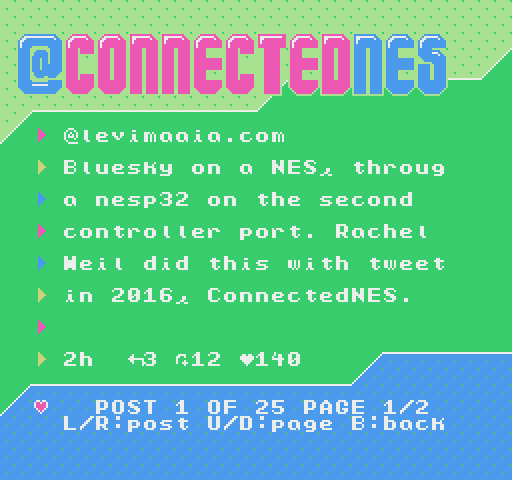
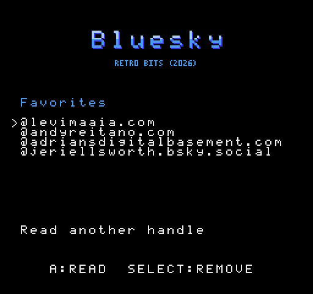
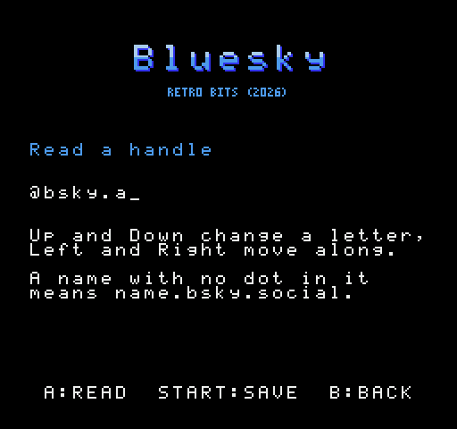
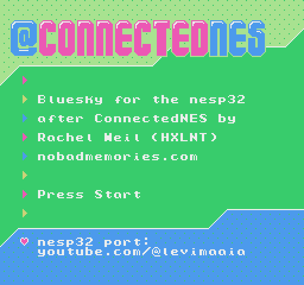

# Bluesky

An account's latest posts on a NES, a card at a time, from a list of
favorites the nesp32 keeps. A [nesp32](../..) on controller port 2 asks
Bluesky for the posts and lays each out as a card; the ROM draws it.

It is [ConnectedNES](https://github.com/hxlnt/connectedNES)'s idea:
Rachel Simone Weil put tweets on a NES in 2016, through a Particle Photon
on the second controller port. This ROM begins with her splash screen,
and a post is on her screen as a tweet was: eight lines of 24 characters
in her font, each after one of her arrows, the handle first and the date
last (her files and her licence are in [`connectednes/`](connectednes)).

On the nesp32 it is the BSKY service, in
[nesp32's `docs/PROTOCOL.md`](../../docs/PROTOCOL.md).






## Status

**It has not yet run on hardware.** On a simulated console the ROM is run
against nesp32's own firmware code, over a line that models every bit,
with the test as Bluesky: the splash, the favorites, a post from what
Bluesky really sent for an account, the form, a favorite saved and one
taken off, and every write to the screen inside a vblank. It is the eighth
program on nesp32's cartridge (`make cart` at the top), where it starts
from the menu on a simulated console.

| Part | State |
|---|---|
| BSKY on the nesp32: a handle to its posts as cards; the favorites, kept | tested on a computer, from a reply Bluesky really sent |
| The ROM (`build/bluesky.nes`, NROM-128) | tested on py65 against that code, over the simulated line |
| The cartridge | on it, the eighth program, in its last free bank; starts from its menu on a simulated console |

## Building

Needs [cc65](https://cc65.github.io/) (`ca65`, `ld65`), a C compiler,
Python 3, and nesp32, the top of this repository.

```sh
make            # build/bluesky.nes (NROM-128, mapper 0)
make test
make preview    # docs/screen.png, and -list, -form and -splash
```

## Using it

With the nesp32 on a Wi-Fi network (the [setup ROM](../setup) joins one)
and on controller port 2, start `build/bluesky.nes`. Her splash says
`Looking for the nesp32...` until the nesp32 answers, then `Press Start`.

Every screen after it is hers too, with eight lines where she drew a
tweet, each after one of her arrows, and her blue ground at the foot saying
how it stands and what the buttons do.

**The favorites** come next, a handle a line, the chosen one's arrow
white: handles the nesp32 keeps, over power-off too. With more than eight
lines, they go by as the arrow moves. A nesp32 that has kept none begins with four: `@levimaaia.com`,
`@andyreitano.com`, `@adriansdigitalbasement.com` and
`@jeriellsworth.bsky.social`. Up to ten can be kept.

| | |
|---|---|
| **Up**, **Down** | the arrow; from the last line round to the first |
| **A** | read that account's posts; on the last line, the form |
| **Start**, twice | take that favorite off |
| **Select** | back to the cartridge's menu (on the cartridge) |

**The form** is for any other handle, typed a letter at a time:

| | |
|---|---|
| **Left**, **Right** | the next letter, either way |
| **Up**, **Down** | change it: a space, `a` to `z`, `0` to `9`, `.` and `-`. Held down, it goes on changing |
| **A** | read that account's posts |
| **Start** | save it to the favorites |
| **B** | back to the favorites |

Spaces are left out. A name with no dot in it is taken as
`name.bsky.social`, which is where most accounts are.

The form holds 26 letters, and the nesp32 keeps a handle of up to 27, so
that `@` and the handle fit a line. A `.bsky.social` name of more than 15
letters, or a handle of more than 26 letters on a domain of its own, can't
be read here; Bluesky allows longer ones, but few are.

**A post** is on her screen: the author's handle, six lines of its text
(who reposted it first, for a repost), and how long ago it was posted with
its replies, reposts and likes. Her blue ground under it says which post it
is, and which page of its text when it has more than six lines: `POST 3
OF 25 PAGE 1/2`.

| | |
|---|---|
| **Left**, **Right** | the post before, or after |
| **Up**, **Down** | the post's text, six lines at a time |
| **Start** | save the account to the favorites |
| **B** | back to the favorites |

The status line also says `FETCHING POSTS`, and when something is wrong
`WAITING FOR LINK` (nothing answers), `UPDATE THE NESP32` (the firmware
there has no BSKY), `NO WI-FI`, `NO ONE HAS THAT HANDLE`, `NO POSTS YET`,
or the nesp32's own words for a fetch that failed (`THE SITE SAID 503`).

## Where the posts come from

Bluesky's public API, `public.api.bsky.app`, which wants no account and no
key: `app.bsky.feed.getAuthorFeed` for an account's 25 latest posts, with
its replies to others left out and its reposts in. The nesp32 reads the
reply as it comes, a few dozen kilobytes of JSON, and keeps only the cards.
What is not ASCII becomes the nearest thing that is; emoji are left out.

## Not done

- On hardware, by itself and on the cartridge.
- Reading only: no posting, liking or following, which would want an
  account on the nesp32.
- No hashtags or searches: Bluesky's search wants an account.
- An account's posts, and not a feed of many accounts'.
- A post's pictures, links and quoted posts are not shown, only its text.
- A post longer than eighteen lines ends with `...`.
- Her balloons, the sprites that rose over her screen, are not here.
- No way to read further back than the 25 latest.

## Tests

```sh
python3 -m venv .venv && .venv/bin/pip install -r requirements-dev.txt
.venv/bin/python -m pytest
```

`make test` does the same, with nesp32's Python if it has one. The console
and the serial line are nesp32's own tests' (`../../tests/console.py`,
`wire.py`), and Bluesky's answer is the one in nesp32's `tests/fixtures`.
A post on the screen is held to the lines nesp32's own code makes of that
answer. The console lets the PPU be written to only inside an NMI while
the picture is on, and the tests check that each NMI's writes end inside
the vblank.

## Credits

The splash screen, the screen a post is on, their font and their palettes
are Rachel Simone Weil's,
from [ConnectedNES](https://github.com/hxlnt/connectedNES), under the MIT
licence ([`connectednes/LICENSE`](connectednes/LICENSE)). The arrow and
the form's mark are NESpedia's font's.
