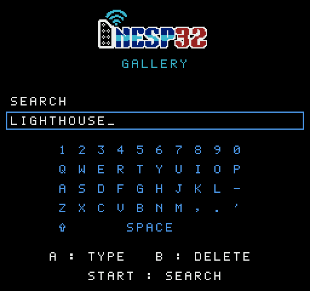
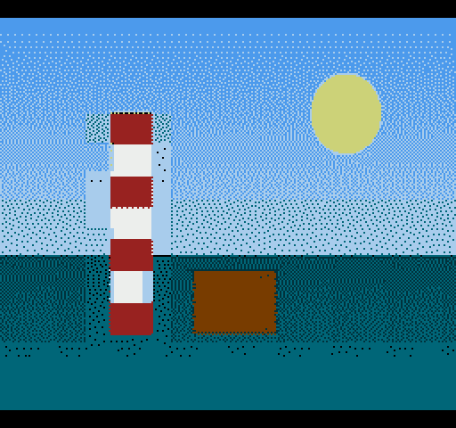

# Gallery

Pictures from [Wikimedia Commons](https://commons.wikimedia.org) on the
Nintendo Entertainment System. Type a few words on the console, and a
[nesp32](../..) on controller port 2 finds pictures for them, makes each
one into the NES's tiles and colours, and sends it over to be shown full
screen.

The Gallery is this ROM and nesp32's COMMONS service
([`docs/PROTOCOL.md`](../../docs/PROTOCOL.md)); there is no firmware of
its own.

 


The last is a test picture (`tests/fixtures/commons_tower.jpg` at the top
of nesp32, made for the tests), as the nesp32's own code makes it and the
NES draws it.

**A prototype.** It runs on a simulated console against the firmware's
code, with the tests in place of Commons. It has not run on hardware, nor
in an emulator, and the firmware with COMMONS has been built but not run
on a nesp32.

## Using it

Controller 1:

| | Search screen | Info page | Picture |
|---|---|---|---|
| D-pad | move over the keys | Left, Right: the picture before or after | the same |
| A | type the key; on ⇧, small letters / capitals | | |
| B | delete; while searching, give up | back to the search | back to the search |
| Start | search | | |
| Select | on nesp32's cartridge, back to its menu; by itself, nothing | the same | the same |

A Bluetooth keyboard paired with the nesp32 works too: letters, Backspace
and Enter on the search screen, as in NESpedia; the arrows, Escape (B) and
Ctrl and Escape (Select) everywhere.

A search finds up to 20 pictures. Each has an info page first, while the
nesp32 fetches and makes it: its name, who made it, and its licence, which
most licences on Commons ask to be shown. Then the screen goes dark for
about two and a half seconds while the picture comes in, and it is shown.

**Safe search.** Commons has none of its own. COMMONS keeps to the
pictures Commons's people have judged to be good photographs (Quality and
Featured pictures), rules out words that mark adult pictures in the search
itself, refuses a search with such a word (it finds nothing), and drops a
picture whose name has one. It is a filter of words: it keeps most such
pictures out, not every one.

## Building

Needs [cc65](https://cc65.github.io/) (`ca65`, `ld65`), a C compiler,
Python 3, and [nesp32](../..), the top of this repository (or `NESP32=`).

```sh
make                         # build/gallery.nes
make test
make preview                 # build/search.png and build/info.png
make picture FILES=photo.jpg # photo.nes.png: the photo as the Gallery shows it
```

`build/gallery.nes` is mapper 0 (NROM-256) with 8 KB of CHR RAM, not CHR
ROM, and vertical mirroring: a picture brings its own tiles. Flash
cartridges and emulators generally run such a ROM; it has not been tried
on one. It is not on nesp32's cartridge, whose MMC1 has CHR ROM.

## How it works

- **The nesp32 does the picture.** COMMONS asks Commons's API for a
  search, keeps each picture's thumbnail address, name, author and
  licence, and when the console opens one, fetches the thumbnail (a JPEG
  330 pixels wide, made by Commons), decodes it and makes it into a
  picture: four palettes of three colours over black, chosen for it, one
  for each square of 16 x 16 pixels, the pixels dithered in them, and at
  most 511 different tiles. On this Mac that takes about 40 ms; on a
  nesp32 it has not been timed.
- **A picture has two pattern tables of tiles.** The top 15 rows of tiles
  come from the first and the bottom 15 from the second; the ROM changes
  table between them every frame (`nes/viewer.inc`, `split`), on the top
  half's last line, where sprite 0 is hit. Sprite 0 is one pixel the
  nesp32 put behind a pixel of the picture, in black, so it is not seen;
  the nesp32 also works out the delay from the hit to the write for where
  it is, so that the write lands in the hblank on an NTSC console and a
  PAL one.
- **The picture comes in with the screen dark.** It is 9256 bytes: the
  tiles, the nametable, the palettes and sprite 0. The ROM asks for 64
  bytes a frame over the link and writes them straight to the PPU, with
  rendering off, so there is no vblank to fit them in. The NMI stays on,
  since the link's library needs it, and keeps off the PPU meanwhile.
- **The font is in PRG ROM.** A picture fills the CHR RAM, so the font is
  copied back for the search screen and the info page.
- **The search screen is NESpedia's** ([`apps/wiki`](../wiki)): its
  keyboard (`nes/keyboard.inc`) and its screen generator
  (`tools/gen_screen.py`), copied and changed for the Gallery.

## To do

- Try it on hardware: a nesp32 with this firmware, on a real NES and on
  the MiSTer, with a flash cartridge that has CHR RAM; time the making of
  a picture on a StickS3 and on a StickC Plus2 (which has less memory to
  make it in).
- Load a picture faster: a run of RAW's (as the Jukebox's sound is) in
  place of 145 exchanges.
- Pictures that are not JPEGs: the decoder takes PNGs, but the search
  asks only for JPEGs.
- The palettes: squares whose palette differs from their neighbours' show
  as blocks, worst in skies and gradients.
- On nesp32's cartridge, once it has CHR RAM.
