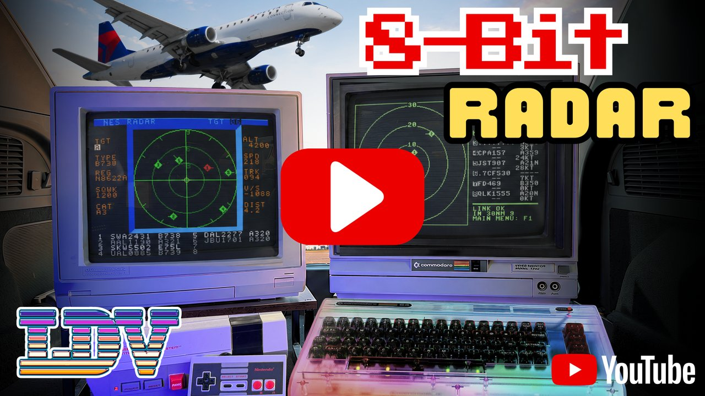
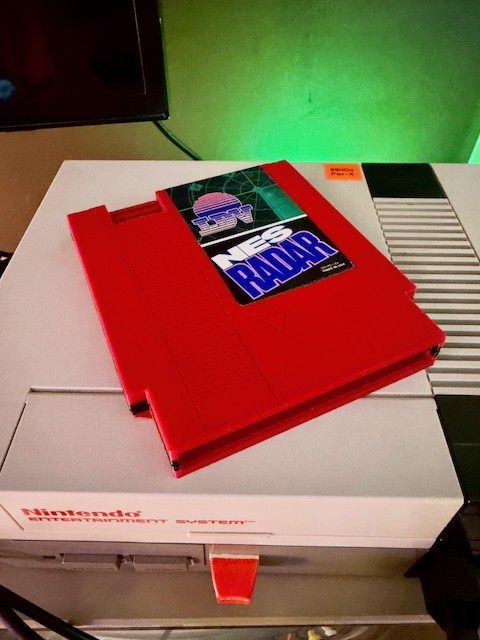

# NES Radar, on a nesp32

**NES Radar turns a real Nintendo Entertainment System into a live air
traffic scope.** It is k6lcm's [nes-radar](https://github.com/k6lcm/nes-radar),
which from 0.5.0 runs with a [nesp32](../..) on controller port 2.

Type any airport's four-letter ICAO code on the NES controller, press
Start, and the aircraft actually flying near that airport *right now*
appear as moving targets on your TV. It works for airports worldwide.
Point it at your local field and watch the approach traffic line up, or at
KLAX and watch it get busy. Watch this
[video demo](https://youtu.be/hZ8sniz4Z2M?si=-s4Dm2YlZwRVx9xd).

[](https://youtu.be/hZ8sniz4Z2M?si=-s4Dm2YlZwRVx9xd)

The NES can't reach the Internet, so the nesp32 does it instead: it
fetches live traffic from [adsb.fi](https://adsb.fi) over Wi-Fi, asks
[Wikidata](https://www.wikidata.org) where the airport is, and hands the
scene to the ROM over nesp32's link. NES Radar is based on
[c64u-radar](https://github.com/k6lcm/c64u-radar), a similar program for
the Commodore 64.


*The data blocks show TGT: Target #, TYPE: Aircraft Type, REG:
Registration, SQWK: Squawk Code, CAT: Category, ALT: Altitude, SPD: Speed
(kts), TRK: Track (degrees), V/S: Vertical Speed (ft/min), DIST: Distance
From Airport/Center.*

## What you need

- A real NES, and either a flash cartridge with the ROM on it or
  [nesp32's cartridge](../../docs/DEVELOPMENT.md#the-cartridge), where NES
  Radar is on the menu
- A nesp32 on controller port 2, with nesp32's firmware flashed
  ([its README](../../firmware/README.md)) and put on Wi-Fi with
  [Setup](../setup)
- A normal controller in port 1, to enter the airport code
- A Wi-Fi network with Internet access

The ROM is on nes-radar's
[Releases page](https://github.com/k6lcm/nes-radar/releases), or built here
(below).

## Using it

1. Load the ROM with the nesp32 in port 2, or choose NES Radar from the
   cartridge's menu. The splash shows the version, `V0.6.0`, for two
   seconds; on a ROM by itself Start skips it.
2. Up and Down change a letter, and Left and Right move along the
   four. The editor begins at the last airport the nesp32 found, which it
   keeps when it is switched off; with none kept, or no nesp32, at `KSBA`.
3. Press Start or A.

On the scope the direction buttons choose among the aircraft, and B goes
back to the ICAO editor. **On the cartridge, Select goes back to the menu
from the editor or the scope** (the editor says `SELECT MENU`), as Reset
does. On a ROM by itself there is no menu, and Select does nothing.

| The editor says | |
|---|---|
| `REQUESTING` | the nesp32 is being asked, and is asking where the airport is: a second or two |
| `INVALID AIRPORT` | Wikidata knows no airport with those letters as its ICAO code |
| `LOOKUP FAILED` | Wikidata did not answer. Start or A asks again |
| `NO NESP32 ANSWER` | no nesp32 is there, or it is running something else |
| `NESP32 NO WI-FI` | Setup has not been run, or the network is out of reach |
| `UPDATE NESP32` | its firmware is older than this ROM, and has no RADAR |

| The scope's `LINK` says | |
|---|---|
| `LIVE` | the nesp32 answers, and the scene on the screen is good |
| `LIVE...` | new data is coming in: a scene, or its aircraft's names. The dots go one, two, three, for half a second |
| `WAITING` | nothing has come of the aircraft yet, or for ten seconds, or for thirty from adsb.fi |
| `NO ANSWER` | the nesp32 has stopped answering. The last scene stays |
| `BAD DATA` | the nesp32 sent an aircraft or a name that cannot be shown |
| `ADSB DOWN` | the nesp32's last fetch from adsb.fi failed. The last scene stays |

The nesp32 fetches the aircraft every eight seconds, so `LIVE...` comes
round about that often.

## Limits

- The scope covers **9 nautical miles** and shows at most **eight
  aircraft**. More than four markers sharing scanlines take turns in front,
  with deliberate NES sprite-priority flicker.
- Live traffic needs the nesp32 to reach adsb.fi and Wikidata over HTTPS.
- Wikidata has most airports and not all: of 60 of nes-radar's taken at
  random it had 55, the rest small fields. It puts some a little way from
  where other databases have them.
- PAL consoles are not claimed.

**It works on hardware** with nesp32's firmware, as a ROM by itself and on
nesp32's cartridge: an airport is found, its aircraft are on the scope,
the nesp32 switched off and on begins at the same airport, and the
cartridge's Select goes back to its menu. It is also tested on a simulated
console against nesp32's own RADAR service, over a cycle-exact line. No
figures have been taken from a console, and no run has been of any
length.

## Building it

**The program is not in this repository.** It is nes-radar, a submodule
at `third_party/nes-radar`: its ROM's source has nesp32's link in it, and
a copy of nesp32's link library (`nes_radar/vendor/nesp32`), so nes-radar
builds by itself with cc65. What is here builds it for the tests and for
nesp32's cartridge, and its tests.

```sh
git submodule update --init third_party/nes-radar
make            # build/nes_radar_link.nes
make verify     # its size and header, and nes-radar's copy of the link library still nesp32's
make cart CART_CHR=10    # build/nes_radar_cart.nes, for nesp32's cartridge, which asks for it itself
make test       # needs: python3 -m venv .venv && .venv/bin/pip install -r requirements-dev.txt
```

Needs cc65 (`ca65`, `ld65`), Python 3, and a C compiler: the tests build
nesp32's firmware's link and services for this computer.

`build/nes_radar_link.nes` is the ROM for a nesp32, the same as
nes-radar's own build of it. It says hello to nesp32's firmware as `RADR`
and asks for the RADAR service. It is a CN-ROM (mapper 3) with 32 KB of
PRG and 32 KB of CHR.

A CN-ROM changes its tiles by a write to the ROM, which the cartridge's
MMC1 would take for itself, so the cartridge has a build of its own,
`nes_radar_cart.nes`, with `CART` defined: it asks the MMC1's CHR register
for the splash's tiles and the scope's, with each page once in place of the
CN-ROM's four. It is a part of that cartridge and not a ROM to run by
itself: it counts on the menu having set the mapper, and is built for the
place on the cartridge its tiles have (`CART_CHR`). The same build makes
Select return to the menu from the editor or scope, says `SELECT MENU` in
the editor, and leaves the splash up for its two seconds, since the Start
that chose it from the menu is still held.

## What the nesp32 changed, and what it did not

Everything on the screen is nes-radar's, and so is every check of what
goes there: the editor, the scope and its sprites, the selected aircraft,
the table, the validation of a record. The nine bytes of an aircraft and
the twenty-five of its names are nes-radar's, byte for byte, and nesp32's
tests hold the RADAR service's to the ones nes-radar's 0.4.4 server makes
of the same reply from adsb.fi.

What is replaced is the line and everything that was there because of it.
The 0.4.x server streamed packets at 9600 baud whenever it liked, so its
ROM had a receiver calibrated by hand, chunks with gaps to draw in, a
window in which the host promised to keep quiet, a heartbeat to keep the
sprites turning, and a request to pause before the editor could be shown.
On nesp32's link the console asks and the nesp32 answers, at 85227 baud,
so none of that is needed:

- **The scope is a loop that goes round once a frame**, and makes at most
  one exchange each time: twice a second it asks for the scene, by the
  serial of the one it has, and is sent the aircraft only if they are
  others. The pad is read every frame and the targets take their turns in
  front every frame, whatever the link is doing.
- **Names are fetched before the scene they belong to**, a slot a frame,
  and only when a scene's reply says they have changed.
- **B returns to the ICAO editor at once.** There is nobody to ask.
- **A nesp32 switched off and on** is told who is on the console and
  which airport again, and the scope goes on.
- **The nesp32 has no table of airports.** The 0.4.x server had ten
  thousand of them in a file; the nesp32 asks Wikidata for the one it is
  given, so the same aircraft can be a point or two away on the two
  scopes.
- **`LINK`'s states are the nesp32's.** `IDLE`, `RECEIVING` and the
  numbered `ERROR 1` to `ERROR 5` were about the cable's packets.

## The airport the nesp32 keeps

The last airport found is kept in the nesp32's flash: its four letters and
where it is, twelve bytes, in the same settings as the address the
netplay games last joined (NVS, under `nesp32`). It is written when an
airport is found that is not the one already kept, and by another task
than the link's, so an exchange never waits on the flash.

- **The editor begins at it.** Just after the splash the ROM says hello
  and asks RADAR for the letters (`LAST`), and they take the place of
  `KSBA`. That is at most eight frames of waiting with no nesp32 there.
- **Start on it asks Wikidata nothing.** The place is known, so the first
  fetch is of the aircraft, and the scope comes up with Wikidata out of
  reach.
- **Only the one airport is kept.** Going between two asks after each
  again. And a kept place is not asked after afresh while the airport
  stays the same: if Wikidata's is corrected, choose another airport and
  come back.

Nothing on the console makes the nesp32 forget it: the next airport found
takes its place.

## The line

The ROM keeps its NMI off but for the moment it waits for a vblank to
write in. Every exchange is made with it off, just after such a write,
and the receiver gives up by counting (nesp32's `gen_link.py --timeout`).
The tests hold the ROM to nothing being written to the PPU outside a
vblank, and to the line never being listened to with the NMI on.

[`docs/PROTOCOL.md`](../../docs/PROTOCOL.md) has the RADAR service, and
nes-radar's `nes_radar/PROTOCOL.md` its records.

## What is where

| Path | Purpose |
|---|---|
| `nes/mmc1_cart.cfg` | the linker configuration for the cartridge's build, with two pages of CHR |
| `tests/` | a console on py65, a nesp32 and the line between them, and the test in place of Wikidata and adsb.fi |
| `docs/` | the pictures here, from nes-radar's `assets` |

In nes-radar, `nes_radar/nes/radar_link.inc` is the link's code (the
hello, the airport, the scope's loop and its exchanges), and
`nes_radar/nes/cnrom256.cfg` has a place for the serial routines.

## Changing nes-radar's code

Change it in nes-radar, in `third_party/nes-radar` if you like (it is a
full clone of it), push it there first, and then move the submodule here
to the commit. When nesp32's link protocol changes, run nes-radar's
`tools/update_nesp32.sh` against this repository and commit what it
writes there: `make verify` here says when it is needed.

To keep the two in step:

- Before pushing either repository, run `make -C apps/nes-radar verify
  test` and `pytest tests/test_cart.py tests/test_radar.py` here against
  the change.
- Get the commit onto nes-radar's `main` with a merge commit, not a
  squash, before pushing anything here. Never push a commit here whose
  submodule points at a nes-radar commit GitHub doesn't have.
- When `make verify` says nes-radar's copy of the link library
  (`nes_radar/vendor/nesp32/`) differs from this repository's, fix it in
  nes-radar with `update_nesp32.sh`, never by editing the copy.
- `tests/fixtures/nes-radar-server/` is a frozen copy of nes-radar's 0.4.4
  server, which the RADAR service's scenes are held to. Don't update it
  from nes-radar: nes-radar has no server from 0.5.0.

## Not done

- Figures from hardware, and a long run.



## Licence

nes-radar is k6lcm's, under the
[GPL-3.0](https://github.com/k6lcm/nes-radar/blob/main/LICENSE), and so
is the ROM built here; the files in this directory are under the same
licence, as all of nesp32 is ([LICENSE](../../LICENSE)). The pictures in
`docs/` are k6lcm's, from nes-radar's `assets`: the video's thumbnail
made smaller, and the cartridge's photograph without its camera data.
nesp32's RADAR service is written from nes-radar's documents of its
records, not from its server's code, which the tests only run beside it.
The aircraft are adsb.fi's, from its open data API, and where an airport
is comes from Wikidata, whose data is
[CC0](https://creativecommons.org/publicdomain/zero/1.0/).
