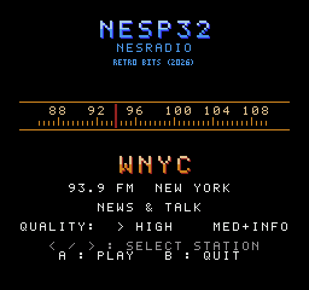

# National Public Radio

NPR's live radio stream on a NES, through the console's own sample
channel. A [nesp32](../..) on controller port 2 fetches the stream from the
Internet, decodes it, and sends it to the console a byte a sample; the ROM
writes each byte to `$4011`, the channel's 7-bit DAC, as it arrives.

A menu offers it two ways: **high quality**, 20338 samples a second and
nothing else, or **medium quality with the news**, 11622 samples a second
with NPR's headlines on the screen, one with its summary for half a minute
and then the next.

A proof of concept, with the one station. The way a sound takes the serial
line over is [the jukebox's](../jukebox) sampled sound, and so are the
routines that play it; the one with the headlines has the cycles it had to
spare put to receiving and drawing them. On the nesp32 it is the TUNER
service, in [nesp32's `docs/PROTOCOL.md`](../../docs/PROTOCOL.md).

## Status

**It played on hardware in what is now the high-quality mode**: from a
StickS3, at 20338 samples a second, speech was entirely clear, if a little
quiet, and in a first minute the nesp32's ring neither ran dry nor dropped
anything. **The menu and the mode with the headlines have had a first run
on hardware, and worked**, and so has pausing, also for longer than the
nesp32 holds. After a few minutes with the headlines and several pauses
its figures were 21 seconds held, dry 0, cut 8: the ring never ran dry,
the pauses had cost eight seconds of the station, and what played was 21
seconds behind it. No long run has been made of either mode, and nothing
else was measured. On a simulated console the ROM plays the station from nesp32's own firmware code,
over a line that models every bit: each sample the nesp32 sends reaches
the DAC, once and in order, and every write to the screen during a sound
falls in a vblank.

| Part | State |
|---|---|
| TUNER on the nesp32: the stream fetched, decoded (MP3), resampled and made into levels for the DAC | worked on a StickS3 at 20338; tested on a computer at both rates, with the test as the Internet |
| The headlines: NPR's news feed fetched, laid out as pages, and sent in the samples | tested on a computer, with a feed of the test's own; the laying out once by hand with NPR's |
| The ROM (`build/npr.nes`) | worked on hardware with a StickS3 before the menu and the headlines; tested on py65 against that code, over the simulated line |
| A nesp32 decoding the stream as fast as it arrives | measured on a StickS3, with no console: 11.5% of one core ([nesp32's firmware](../../firmware/README.md), "The radio") |
| How it sounds | clear speech on hardware, and quiet. `tools/npr_preview.py` gives it without a console |

## Building

Needs [cc65](https://cc65.github.io/) (`ca65`, `ld65`), a C compiler,
Python 3, and nesp32, the top of this repository.

```sh
make            # build/npr.nes (NROM-256, mapper 0)
make test
```

## Playing




With the nesp32 on a Wi-Fi network (the [setup ROM](../setup) joins one)
and on controller port 2, start `build/npr.nes`. The screen's header is
nesp32's, with `NATIONAL PUBLIC RADIO` under the name; the nesp32's own
screen calls the program `NPR`.

| | |
|---|---|
| **Up**, **Down** or **Select**, before a station is tuned in | the menu's other line: `HIGH QUALITY, NO HEADLINES` or `MED QUALITY, HEADLINE NEWS` |
| **Start** or **A** on the controller | tune in, as the menu says: `TUNING`, and a second or two later `ON THE AIR`. Pressed again while it is tuning, give it up |
| **A** on the controller, while the station plays | pause: `PAUSED`. Start or A plays it again, at once |
| **A** (front) on the nesp32 | tune in; and while the station plays or is paused, turn it off |

**While the station plays, A on the controller pauses it and the nesp32's
button stops it.** A console playing sampled sound does nothing else: its
screen stands still, and of its controller it looks at button A alone,
once a sample (the jukebox's `docs/PROTOCOL.md`, part 4, has how). Start
is not seen until the station is paused. Reset works too: the nesp32
hears the console say hello and ends the sound.

A paused station is fetched still, so that it plays again without tuning:
the nesp32 holds its last 12 seconds (22 with the headlines, at their
lower rate), and goes on from the oldest of
them. Paused for longer than that, it has skipped what fell between.
A station that has been paused for long plays from then on with the
nesp32's ring nearly full, as far behind the station as it can be, and
with no room to spare: whenever the station gets a little ahead of the
console another second is dropped.

### The headlines

With the menu's second line, the nesp32 first fetches NPR's news feed
(`https://feeds.npr.org/1001/rss.xml`) and lays out its stories, up to
sixteen, a page each: the headline on up to three lines, and under it as
much of the summary as the rest of nine holds. Then it tunes the station
in, which this makes a second or two longer.

The first page is on the screen about half a second after the sound
begins. Every 30 seconds the next takes its place, and after the last the
first again. Paused, the page stays; played again, it has its whole half
minute. If the feed cannot be had the station plays without, and the
middle of the screen is blank.

They are the headlines of the moment the station was tuned in, until it is
turned off and tuned in again: the nesp32 fetches one thing at a time, and
the station's stream never ends.

**Nothing of the sound is given up for them but the rate.** The console's
DAC takes seven bits of each byte, and the nesp32 sends a character of
the page in the eighth, eight samples to a character: a page takes under a
fifth of a second, and no sample is held or missed for it. The console
keeps the page it is being sent and no other, so the feed can be as long
as it likes. How a console with no cycles to spare takes the characters
in, and draws a page in the middle of a sound, is at the head of
[`tools/gen_news.py`](tools/gen_news.py), which writes the routine. In
short: at 14 CPU cycles a bit there are 8 spare between one look at the
line and the next, seven times a sample. Three of those take the bit and
count it; when a page is whole the routine asks the PPU once a sample
whether vblank has begun, and in four vblanks running draws the page, a
character to each 8 cycles, on the nametable that is not shown, then
changes the two over.

The status line says what is wrong when something is: `WAITING FOR LINK`
when nothing answers, `UPDATE NESP32` when the firmware there has no TUNER,
`NO WI-FI`, and the nesp32's own words when the stream cannot be had or is
lost (`THE SITE DID NOT ANSWER`, `THE CONNECTION DROPPED`). Start tries
again.

The nesp32's screen shows `NPR` and how it stands; while the station
plays, `ON THE AIR`. How its ring fares is in its log, on the USB serial
port, every two seconds while the station plays:

```
npr: on the air, 21s held, dry 0, cut 8
```

the seconds it holds ready, and two counts that should stay at 0 for hours
at a time unless the station is paused: `dry`, times it had nothing to
send and held the sound where it was, and `cut`, seconds dropped because
the station ran ahead of the console, or was paused for longer than the
ring holds.

## Hearing it without a console

```sh
make -C ../.. host
tools/npr_preview.py --live 20 build/npr_nes.wav    # the station, for 20 seconds
tools/npr_preview.py some.mp3 build/some_nes.wav
```

The stream goes through the nesp32's own code, built for this computer,
and what it would put on the line is written as a WAV file of the DAC's
output: 7 bits through the DAC's curve, at 20338 samples a second, the
high-quality mode's. The console's filters are not in it.

## Not done

- A long run, a real NES, and the StickC Plus2.
- More than one station, and a station's name or programme on the screen.
- A long run on hardware of the mode with the headlines. A write to the
  PPU that fell outside vblank would show as a flicker or a wrong
  character; a first run showed neither, and the tests say that on the
  simulated console no write does.
- Start during the sound: only A is looked at, and not in the samples that
  bring a character of a page (a fifth of a second in thirty).
- A station played again after a long pause brought nearer to the moment,
  with room in the ring, in place of from its oldest second.
- Headlines newer than the moment of tuning in, which want a second fetch
  on the nesp32 while the station plays.
- A samples' stall in the middle of a page being drawn. The drawing goes at
  the pace of the samples; if the nesp32 fell silent for more than a
  millisecond or two just then, the rest of that vblank's writes would come
  late. It sends without pause, also when its ring is dry, so this has not
  been seen, and is not guarded against.
- A sample misread in the mode with the headlines may be a character
  misread: a wrong letter on the page until the next, or at worst the
  sound ended, as by the nesp32's button.
- Loudness. A sample goes to the DAC at the level the station sent it, and
  speech uses about a third of the DAC's range; a gain that followed the
  programme would use more of the 7 bits.
- A stream that is lost is not fetched again by itself.
- The cartridge with this on it, on hardware: it is the sixth program there
  (nesp32's `make cart`), and starts from the menu on a simulated console.

## Tests

```sh
python3 -m venv .venv && .venv/bin/pip install -r requirements-dev.txt
.venv/bin/python -m pytest
```

`make test` does the same, with nesp32's Python if it has one. The console
and the serial line are the jukebox's (`../jukebox/tests`), and the
station's stream is an MP3 of a tone from nesp32's `tests/fixtures`, with
a news feed beside it. The console's PPU is modelled as far as the sound's
routine needs: `$2002` says when vblank begins, and every write to the PPU
with the NMI off is checked to be inside one. They need cc65 and skip
without it.
