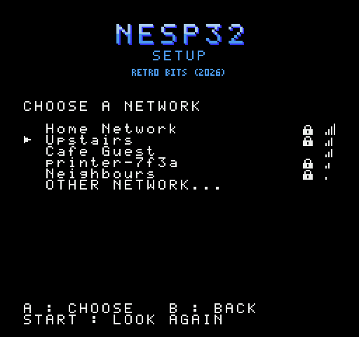
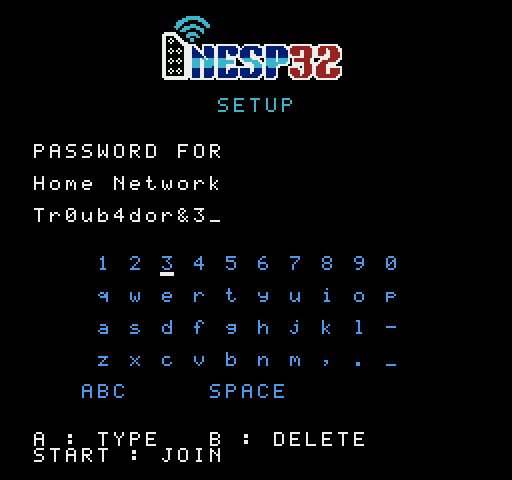
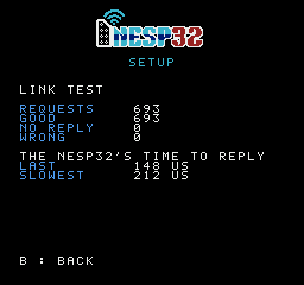
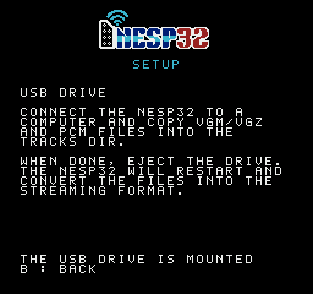
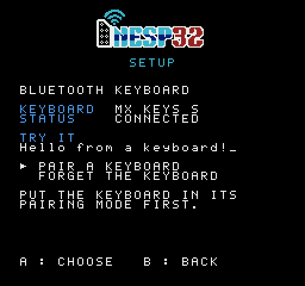

# nesp32 Setup

A [nesp32](../..) has no keyboard. This ROM is its setup: plug the nesp32
into controller port 2, run the ROM, and use controller 1. It shows what
the nesp32 is and how it is doing, puts it on a Wi-Fi network, tests the
link, lends a StickS3's files to a computer as a USB drive, and pairs a
StickS3 with a Bluetooth keyboard.

 
 
 

It is also the first user of nesp32's link, and the ROM that the tests of
the link are run on. It is one of the programs on
[the cartridge](../../docs/DEVELOPMENT.md#the-cartridge).

## Status

**It works on hardware.** With a StickS3 on the MiSTer's NES core,
through a SNAC adapter, it found the nesp32, joined a Wi-Fi network from
the controller, and the nesp32 joined it again by itself after a power
cycle. The link test ran 6000 requests with every one good, and the
nesp32's slowest reply was 215 microseconds
([the firmware's README](../../firmware/README.md), "On hardware"). It has
also run from the cartridge on a real NES, and with a StickC Plus2; no
figures were taken from those runs.

The USB drive works on hardware too: a StickS3's files lent to a
computer, and music copied to it.

## Using it

| Screen | Buttons |
|---|---|
| Status: the nesp32, its firmware, its Wi-Fi, address, signal, battery, and a menu: Wi-Fi setup, test interface, enable USB drive, Bluetooth keyboard, flip LCD, and on the cartridge quit | Up, Down. A: choose |
| Networks, strongest first, with a lock on those that want a password | Up, Down. A: choose. Start: look again. B: back |
| Keyboard, for a password (or the name of a network that hides it) | D-pad. A: type; on the set key, left of the space bar, `abc`, `ABC` or `#+=`. B: delete. Start: join |
| Link test: a checked request every frame, and the nesp32's time to reply | B: back |
| USB drive: a StickS3's files lent to a computer, for music to be copied to | B: back, and the nesp32 restarts |
| Bluetooth keyboard: the keyboard paired, how it stands, and a line that shows what is typed on it | Up, Down. A: choose: pair a keyboard (look for them, and list them) or forget the one paired. B: back |
| Keyboards found, strongest first | Up, Down. A: pair. B: back |

Every printable character can be typed, and a password may be the full 63.
The nesp32 saves the network and joins it by itself from then on. The
password goes to the nesp32 and is never sent back.

Flip LCD turns the nesp32's own screen the other way up, and the
nesp32 keeps it that way when it is switched off. Quit goes back to the
cartridge's menu, as reset does, and so does Select from any screen; a
USB drive is taken back first, as B does. Setup built as a ROM of its own
has no menu to go back to, and no Quit.

A Bluetooth keyboard is for the programs that take text, NESpedia first.
Put it in its pairing mode, then choose PAIR A KEYBOARD on the keyboard
screen and the keyboard from the list; there is no code to type on it. The
nesp32 keeps it, and connects it again whenever a program that uses it is
running and a key is pressed on it. Only a StickS3 has Bluetooth, and only Bluetooth LE
keyboards pair: most made in the last few years are, and an older one that
is Bluetooth Classic alone is not found. Bluetooth is on only while this
screen or such a program is up.

The USB drive is how the jukebox's music gets onto a StickS3:
[nes-jukebox](../jukebox/README.md#music-on-a-nesp32) has what to copy and
where.

## Building

```sh
make            # build/setup.nes
make verify     # its size and header
make test       # needs nesp32's requirements-dev.txt, at the top
make preview    # the pictures above, from the ROM itself
```

Needs [cc65](https://cc65.github.io/) (`ca65`, `ld65`) and Python 3.
`build/setup.nes` is NROM-256 (mapper 0). `make rom` at the top of the
repository builds the same ROM into the build directory there, for the
tests and for the cartridge.

## What is where

| Path | Purpose |
|---|---|
| `nes/setup.s` | reset, the NMI, and the screens' common code |
| `nes/status.inc`, `nes/wifi.inc`, `nes/keys.inc`, `nes/test.inc`, `nes/usb.inc`, `nes/kbd.inc` | each screen: status, networks, the keyboard on the screen, the link test, the USB drive, the Bluetooth keyboard |
| `nes/nrom256.cfg` | where the linker puts it |
| `tools/gen_screen.py` | the tiles, the header and the layout's numbers. The cartridge's menu has its tiles from here too |
| `tools/preview.py` | the pictures in `docs/` |

The link is nesp32's: [`docs/PROTOCOL.md`](../../docs/PROTOCOL.md) has the
line, the frames and the services this ROM asks for (SYS, NET and DIAG,
and KBD on the Bluetooth keyboard's screen),
and `nes/lib/nesp.inc` at the top is the library it includes.

## Tests

The tests are among nesp32's own, in `tests/` at the top, because they
share its simulated console: `test_setup.py` works every screen with the
controller, to a network joined with a password of every character.
`test_link.py` and `test_link_timing.py` run this ROM too, as the console's
end of the link, and a second build of it (`make timeout-rom`) on the
library's other receiver.
