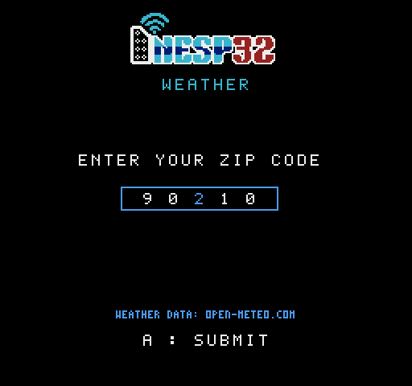

# Weather

The weather for a US zip code on a NES: what it is now, and five days of
it, on one screen, with a small picture for each. A [nesp32](../..) on
controller port 2 asks the Internet where the zip code is and what the
weather is there, and lays the answer out; the ROM draws it.

The zip code is entered once. The nesp32 keeps it in its flash, and the
next time the ROM starts its form has those digits in it: A, and the
weather is on the screen.

On the nesp32 it is the WEATHER service, in
[nesp32's `docs/PROTOCOL.md`](../../docs/PROTOCOL.md).

## Status

**It works on hardware**: the ROM by itself, from a StickC Plus2 and on
the MiSTer. It is the seventh program on nesp32's cartridge (`make cart`
at the top), where it starts from the menu on a simulated console; the
cartridge with it on has not yet run on hardware. On a simulated console the ROM is run against
nesp32's own firmware code, over a line that models every bit, with the
test as the two sites: a zip code entered with the controller, or the
kept one taken with A, its report on the screen tile for tile as the
nesp32 laid it out, and every write to the screen inside a vblank.

| Part | State |
|---|---|
| WEATHER on the nesp32: a zip code to a place, the place's weather to rows of tiles | working on a StickC Plus2; tested on a computer, from replies the two sites really sent |
| The ROM (`build/weather.nes`) | working on hardware, with a StickC Plus2 and on the MiSTer; tested on py65 against that code, over the simulated line |
| The cartridge | on it, the seventh program; starts from its menu on a simulated console, and not yet run there on hardware |

## Building

Needs [cc65](https://cc65.github.io/) (`ca65`, `ld65`), a C compiler,
Python 3, and nesp32, the top of this repository.

```sh
make            # build/weather.nes (NROM-256, mapper 0)
make test
make preview    # docs/screen.png and docs/screen-form.png
```

## Using it




With the nesp32 on a Wi-Fi network (the [setup ROM](../setup) joins one)
and on controller port 2, start `build/weather.nes`. The screen's header
is nesp32's, with `WEATHER` under the name; the nesp32's own screen calls
the program `Weather`, and shows the zip code and the temperature.

The form comes up first, every time: five digits in a box, `00000` the
first time and after that the zip code the nesp32 keeps. One digit
pulses, white through the header's blues and back, as the key under
[NESpedia](../wiki)'s cursor does; it is the one that Up and Down change.

| | |
|---|---|
| **Left**, **Right** | the next digit, either way; from the last round to the first |
| **Up**, **Down** | change it, `9` round to `0`. Held down, it goes on changing |
| **A** or **Start** | ask for that zip code's weather (`A : SUBMIT`) |
| **Select** | on nesp32's cartridge, back to its menu (`SELECT : MENU`), here or from a report; built by itself, nothing |

and with the report on the screen:

| | |
|---|---|
| **B** | the form again (`B : BACK`), to enter another zip code |

A report is the place's name and state, the temperature now with a word
or two for the sky, today's high and low, the humidity and the wind; and
under those five days, today the first, each with its picture, its high
and its low. A day's name is three letters over a picture two tiles wide,
so the ROM draws it in tiles of its own with the letters half a tile to
the left, centered over the picture; the nesp32 sends the plain letters. Degrees are Fahrenheit and the wind is in miles an hour. The
nesp32 fetches the weather again every 15 minutes, and the screen follows
within a second or so.

The status line, under the header, says what is going on when the report
is not there: `FINDING THE ZIP CODE`, `FETCHING THE WEATHER`, and when
something is wrong `WAITING FOR LINK` (nothing answers), `UPDATE NESP32`
(the firmware there has no WEATHER), `NO WI-FI`, `NO SUCH ZIP CODE`, or
the nesp32's own words for a site that failed (`THE SITE DID NOT ANSWER`,
`THE SITE SAID 503`). With either of the last two the form is back, to
put the zip code right or to ask again.

**Only a zip code that was found is kept.** One that no place has is not
remembered, and neither is one typed while a site was down.

### The pictures

Eight, 16 pixels square: the sun, the moon, the sun behind a cloud, a
cloud, fog, rain, snow and a thunderstorm. They are part of the protocol
and not only of this ROM: the nesp32 puts a picture on a row as four tile
numbers, `$60` to `$7F`, where a font would have its small letters, and a
ROM has the drawings at those tiles. This one's are in
[`tools/gen_screen.py`](tools/gen_screen.py), as text. They need no
palette of their own: the font is white, and a picture has yellow and a
light blue besides, so a sun is yellow and rain is blue wherever on the
screen the nesp32 puts them.

## Where the weather comes from

- Where a zip code is, and what the place is called:
  [Zippopotam](https://zippopotam.us) (`api.zippopotam.us/us/90210`),
  asked once for a zip code and not again while the nesp32 keeps it.
- The weather: [Open-Meteo](https://open-meteo.com)
  (`api.open-meteo.com/v1/forecast`), whose data is under
  [CC BY 4.0](https://creativecommons.org/licenses/by/4.0/); both views
  say `WEATHER DATA: OPEN-METEO.COM`, in a 3 x 5 font of its own. **Its free service is for
  non-commercial use**, up to 10000 requests a day; a nesp32 makes one
  when a zip code is chosen and one every 15 minutes while its report is
  on a screen.

Neither wants a key or an account.

## Not done

- The cartridge with this on it, on hardware.
- Zip codes only, and so the United States only. Fahrenheit and miles an
  hour only.
- No hourly forecast: it was left out for the room it took.
- A report that could not be refreshed stays on the screen and does not
  say how old it is.
- The time the report was made is not shown, nor is the nesp32's clock
  used for anything.
- A place's name is cut to fit beside its state: 18 characters.

## Tests

```sh
python3 -m venv .venv && .venv/bin/pip install -r requirements-dev.txt
.venv/bin/python -m pytest
```

`make test` does the same, with nesp32's Python if it has one. The console
and the serial line are nesp32's own tests' (`../../tests/console.py`,
`wire.py`), and the two sites' answers are the ones in nesp32's
`tests/fixtures`. The console lets the PPU be written to only inside an
NMI once the picture is on, and the tests check that each NMI's writes
are over before vblank is. They need cc65 and skip without it.
