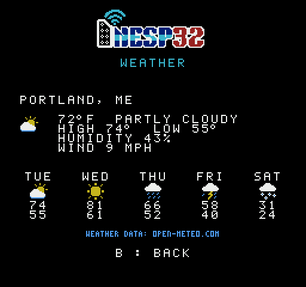
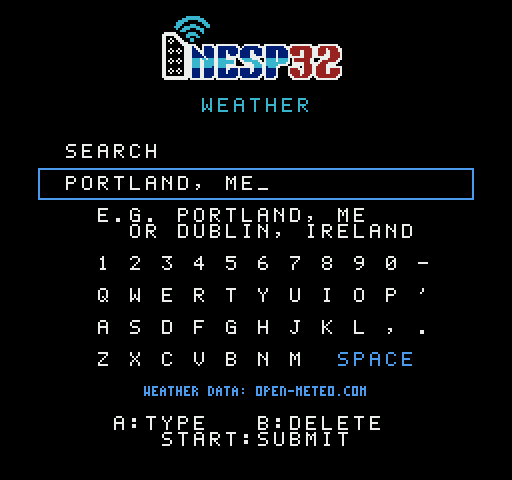

# Weather

The weather for a place anywhere in the world on a NES: what it is now,
and five days of it, on one screen, with a small picture for each. A
[nesp32](../..) on controller port 2 asks the Internet where the place
is and what the weather is there, and lays the answer out; the ROM draws
it.

A place is typed as a city, a comma, and its state or country:
`PORTLAND, ME`, `DUBLIN, IRELAND`. It is entered once. The nesp32 keeps
it in its flash, and the next time the ROM starts its form has the place
in it: A, and the weather is on the screen.

On the nesp32 it is the WEATHER service, in
[nesp32's `docs/PROTOCOL.md`](../../docs/PROTOCOL.md).

## Status

**It works on hardware**: the ROM by itself, from a StickC Plus2. Places,
typed on the screen's keyboard, worked there on 2026-11-23, with the
nesp32's firmware from the same change, which they need; the zip-code
version before them also ran on the MiSTer. It is the seventh program on nesp32's cartridge (`make cart` at the top),
where it starts from the menu on a simulated console; the cartridge with
it on has not yet run on hardware. On a simulated console the ROM is run
against nesp32's own firmware code, over a line that models every bit,
with the test as the two sites: a place entered with the controller or
typed on a keyboard, or the kept one taken with A, its report on the
screen tile for tile as the nesp32 laid it out, and every write to the
screen inside a vblank.

| Part | State |
|---|---|
| WEATHER on the nesp32: a place as typed to where it is, its weather to rows of tiles | working on a StickC Plus2; tested on a computer, from replies Open-Meteo really sent |
| The ROM (`build/weather.nes`) | working on hardware with a StickC Plus2; tested on py65 against that code, over the simulated line. The zip-code version before it also worked on the MiSTer |
| A Bluetooth keyboard on the form (nesp32's KBD) | letters tested on py65 against nesp32's service, not yet on hardware; digits worked on hardware, a StickS3 with a Logitech MX Keys S |
| The cartridge | on it, the seventh program; starts from its menu on a simulated console, and not yet run there on hardware |

## Building

Needs [cc65](https://cc65.github.io/) (`ca65`, `ld65`), a C compiler,
Python 3, and nesp32, the top of this repository.

```sh
make            # build/weather.nes (NROM-128, mapper 0)
make test
make preview    # docs/screen.png and docs/screen-form.png
```

## Using it




With the nesp32 on a Wi-Fi network (the [setup ROM](../setup) joins one)
and on controller port 2, start `build/weather.nes`. The screen's header
is nesp32's, with `WEATHER` under the name; the nesp32's own screen calls
the program `Weather`, and shows the place as typed and the temperature.

The form comes up first, every time: a box of 24 characters, empty the
first time and after that with the place the nesp32 keeps, with `SEARCH`
over it as on NESpedia's; under it two places as they are to be typed; and a keyboard, as
[NESpedia](../wiki)'s search has: the digits and `-`, the letters with
`'`, `,` and `.`, and a space bar. The key the cursor is on pulses, white
through the header's blues and back.

| | |
|---|---|
| **D-pad** | move over the keys, round at the edges; held down, it goes on moving. Up and Down keep the column, and the space bar is under the last four |
| **A** | type the key (`A:TYPE`), at the end of the place, while there is room |
| **B** | delete the last character (`B:DELETE`) |
| **Start** | ask for that place's weather (`START:SUBMIT`). An empty form asks nothing |
| **Select** | on nesp32's cartridge, back to its menu (`SELECT:MENU`), here or from a report; built by itself, nothing |

and with the report on the screen:

| | |
|---|---|
| **B** | the form again (`B : BACK`), to enter another place |

A Bluetooth keyboard paired with a StickS3 ([Setup](../setup) pairs one)
types the place too: a letter (small or capital), a digit or a sign that
the screen's keyboard has is typed; **Backspace** deletes, **Enter** asks
for the weather, the arrows move the cursor as the D-pad does, and
**Esc** is B on a report (the form again) and nothing on the form. A character typed with a report on the screen is the
form again, empty, so the next place can just be typed.

**The first place found is the one taken.** What is typed goes to
Open-Meteo's geocoding as it is, and the nesp32 takes the first place it
gives back, the likeliest: `PORTLAND` alone is Portland, Oregon, and
`PORTLAND, ME` is Portland, Maine. The comma matters (`PORTLAND MAINE`
finds nothing), and a state goes by its two letters or its name, a
country by its name (`DUBLIN, IRELAND`; `PARIS, FR` finds nothing). A
place's name on the report shows which one was found, so a wrong one can
be put right in the form.

A report is the place's name with its state in the United States
(`PORTLAND, ME`), and elsewhere with its region and its country's two
letters (`DUBLIN, LEINSTER, IE`) or, where those would not fit or say the
city again, its country's alone (`TOKYO, JP`); then the temperature now
with a word or two for the sky, today's high and low, the humidity and
the wind; and under those five days, today the first, each with its
picture, its high and its low. A day's name is three letters over a
picture two tiles wide, so the ROM draws it in tiles of its own with the
letters half a tile to the left, centered over the picture; the nesp32
sends the plain letters. In the United States and its territories degrees
are Fahrenheit and the wind is in miles an hour, and everywhere else
degrees are Celsius and the wind is in kilometres an hour. The nesp32
fetches the weather again every 15 minutes, and the screen follows within
a second or so.

The status line, under the header, says what is going on when the report
is not there: `FINDING THE PLACE`, `FETCHING THE WEATHER`, and when
something is wrong `WAITING FOR LINK` (nothing answers), `UPDATE NESP32`
(the firmware there has no WEATHER, or one from before places), `NO
WI-FI`, `NO SUCH PLACE`, or the nesp32's own words for a site that failed
(`THE SITE DID NOT ANSWER`, `THE SITE SAID 503`). With either of the last
two the form is back, to put the place right or to ask again.

**Only a place that was found is kept.** One the geocoding has nothing
for is not remembered, and neither is one typed while a site was down. A
zip code kept by firmware from before places is kept as a place: its five
digits.

### The pictures

Eight, 16 pixels square: the sun, the moon, the sun behind a cloud, a
cloud, fog, rain, snow and a thunderstorm. They are part of the protocol
and not only of this ROM: the nesp32 puts a picture on a row as four tile
numbers, `$60` to `$7F`, where a font would have its small letters, and a
ROM has the drawings at those tiles. This one's are in
[`tools/gen_screen.py`](tools/gen_screen.py), as text. They need no
palette of their own: the font is white, and a picture has yellow and a
light blue besides, so a sun is yellow and rain is blue wherever on the
screen the nesp32 puts them.

## Where the weather comes from

Both from [Open-Meteo](https://open-meteo.com), whose data is under
[CC BY 4.0](https://creativecommons.org/licenses/by/4.0/); both views say
`WEATHER DATA: OPEN-METEO.COM`, in a 3 x 5 font of its own.

- Where a place is, and what it is called: its geocoding
  (`geocoding-api.open-meteo.com/v1/search`), from
  [GeoNames](https://www.geonames.org), asked once for a place and not
  again while the nesp32 keeps it.
- The weather: its forecast (`api.open-meteo.com/v1/forecast`).

**Its free service is for non-commercial use**, up to 10000 requests a
day; a nesp32 makes one when a place is chosen and one every 15 minutes
while its report is on a screen. Neither wants a key or an account.

## Not done

- The cartridge with this on it, on hardware; and places typed on a
  Bluetooth keyboard, on hardware.
- One place for what is typed, the first the geocoding gives: no list to
  choose from. A misspelt place finds nothing.
- No choosing between degrees F and C: the place's country decides.
- No hourly forecast: it was left out for the room it took.
- A report that could not be refreshed stays on the screen and does not
  say how old it is.
- The time the report was made is not shown, nor is the nesp32's clock
  used for anything.
- A place's name is cut to fit its row, with its state or country:
  28 characters.

## Tests

```sh
python3 -m venv .venv && .venv/bin/pip install -r requirements-dev.txt
.venv/bin/python -m pytest
```

`make test` does the same, with nesp32's Python if it has one. The console
and the serial line are nesp32's own tests' (`../../tests/console.py`,
`wire.py`), and the two sites' answers are the ones in nesp32's
`tests/fixtures`. The console lets the PPU be written to only inside an
NMI once the picture is on, and the tests check that each NMI's writes
are over before vblank is. They need cc65 and skip without it.
