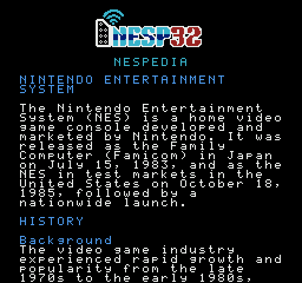

# NESpedia

A Wikipedia reader for the Nintendo Entertainment System. Type a few words
on the console, and an M5Stack Stick on controller port 2 fetches the
article from Wikipedia and hands it over a line at a time, to be read with
smooth scrolling under a fixed header.

The Stick runs [nesp32](../nesp32), one firmware for every NES application
that uses a Stick. NESpedia is this ROM and nesp32's WIKI service; there is
no firmware of its own here any more.

 

It uses the level-shifter hat from [nes-radar](../nes-radar) and
[nes-jukebox](../nes-jukebox). See [`PLAN.md`](PLAN.md) for the design and
[`docs/PROTOCOL.md`](docs/PROTOCOL.md) for the link.

A proof of concept, and work in progress.

## Status

**It works with nesp32's firmware on an M5StickS3**, on the MiSTer's NES
core through a SNAC adapter: a search is fetched from Wikipedia and the
article opens and is read.

| Part | State |
|---|---|
| Reader ROM, search screen and keyboard | working on hardware; tested on py65 |
| Link: the ROM on nesp32's library, and nesp32's WIKI service | working on hardware at 85227 baud; tested together over a cycle-exact simulated line |
| Text: an API reply to 28-column lines | in nesp32, in C; checked there against the Python it was ported from |

Still untried with this firmware: a real NES, the StickC Plus2, an emulator
(the standalone ROM should run in Mesen 2), a long session, and a
television with heavy overscan, where the sides of the box round the search
field may be cut off.

Until October 2026 the Stick ran a MicroPython firmware of NESpedia's own,
which worked on a real NES with a StickC Plus2. It is in this repository's
history, and what bringing it up found is in [`PLAN.md`](PLAN.md), phase 5.

## Building

Needs [cc65](https://cc65.github.io/) (`ca65`, `ld65`), a C compiler,
Python 3, and a checkout of [nesp32](../nesp32) beside this one (or at
`NESP32=`). The link's library for the console comes from it, and so does
the code that lays text out, which is built for this computer so that the
built-in article and the preview are laid out exactly as a Stick does it.

```sh
make                         # build/nespedia.nes and build/nespedia_link.nes
make ARTICLE=some.txt        # the standalone ROM with another text built in
make preview                 # build/search.png and build/reader.png
```

- `build/nespedia.nes` has an article built in and needs nothing on the
  controller port, so it runs in an emulator (Mesen 2 recommended) and from
  a flash cart. Whatever is searched for, it finds that article.
- `build/nespedia_link.nes` asks a Stick for its articles. It says hello
  to nesp32's firmware as `WIKI` and asks for that service.

Both are NROM-256 (mapper 0) with vertical mirroring.

## Using it

Controller 1:

| | Search screen | Reader |
|---|---|---|
| Up, Down | move over the keys | scroll by the pixel, while held |
| Left, Right | move over the keys | a page up, a page down |
| A | type the key | a page down |
| B | delete; while searching, give up | a page up |
| Select | small letters / capitals | back to the search screen |
| Start | search | top of the article |

The field holds 30 characters and starts as `Nintendo Entertainment System`.
The key under the cursor pulses from white through the logo's blues. A page
glides rather than jumps, and keeps two lines in view. The mark at the
right edge shows how far the window is through as much of the article as
has been fetched, so in a long article it runs ahead until the end is in.

To see what an article will look like without a console:

```sh
tools/wiki_preview.py "Famicom Disk System"
```

That runs the Stick's own text code on this computer.

## The Stick

Flash nesp32's firmware ([its `firmware/README.md`](../nesp32/firmware/README.md)),
and put the Stick on Wi-Fi with nesp32's setup ROM, from the controller. A
Stick set up once serves this ROM and every other; nothing on it is chosen
or changed for NESpedia.

The hat is nes-radar's two-transistor level shifter
([its README](../nes-radar/firmware/stick_s3/README.md) has the circuit),
wired for the board: on a StickS3, TX on slot 5 (G8) and RX on slot 4 (G1).

If a search says `NO ANSWER FROM THE STICK`, the Stick is not there, or is
running something else. `THE STICK NEEDS AN UPDATE` means its firmware is
older than this ROM. `THE STICK HAS NO WI-FI` means the setup ROM has not
been run, or the network is out of reach.

## How it works

- **The console never holds the article.** It has 2 KB of memory. The Stick
  wraps the text into lines of exactly 28 characters, and the console asks
  for them by number, at most one a frame.
- **Reading starts before the article has all arrived.** The Stick offers
  it as soon as a screenful is laid out, and the console learns its growing
  length from every reply. Fetching and laying out are another task's work
  on the Stick, on another core from the one that answers the console.
- **A nametable is the cache.** Nametable 0 is a ring of 30 lines: line *n*
  of the article lives in row *n* mod 30. 23 rows can be in view, and the 7
  out of sight hold the lines just beyond the window. A line is only ever
  drawn into a hidden row, and the window only moves onto rows that have
  been drawn, so a slow or lost answer makes the scroll wait and can never
  put the wrong text on the screen.
- **The header is a second nametable**, and each frame changes from it to
  the article at a sprite-0 hit: one pixel sitting on the credit line, in
  that line's own colour.
- **The link is one rate, 85227 baud, both ways**, bit-banged by counting
  CPU cycles. A request and its 40-byte reply fit in the part of a frame
  left after the header. The NMI cuts off an exchange that runs late, and
  it is asked for again.
- **Wikipedia does the stripping.** One API request searches and returns
  the best page as plain text. The Stick reads the reply as it arrives,
  never holding it whole, and maps what is not ASCII to something that is.

## Tests

```sh
python3 -m venv .venv && .venv/bin/pip install -r requirements-dev.txt
make test
```

The ROM tests build both ROMs and run them on py65, so they need cc65; they
skip without it. The full suite takes about two minutes, most of it the
link.

- `tests/console.py` is the simulated console: a frame clock with NMIs, the
  PPU's scroll registers and sprite-0 flag as the ROM uses them, and
  controller 1. Every reader test checks, frame by frame, that the rows in
  view are exactly the article's lines at the place the scroll says.
- `tests/wire.py` is the serial line, cycle by cycle, between the link ROM
  and the Stick's own link and WIKI service, which are nesp32's C built for
  this computer: late, lost, damaged and cut-off replies, a Stick whose
  clock is out, one that goes deaf, one that forgets the article.
- The serial routines' timing, the text code and the service by itself are
  tested in nesp32.

## Not done

- A real NES and the StickC Plus2 with nesp32's firmware.
- A list of search results to choose from: the first result is taken.
- Links, tables and pictures, which Wikipedia's plain text leaves out.
- PAL consoles.
- A licence. Parts are adapted from nes-jukebox, which has none yet.

Wikipedia's text is its contributors', under
[CC BY-SA 4.0](https://creativecommons.org/licenses/by-sa/4.0/); every
article fetched ends with two lines saying so.
