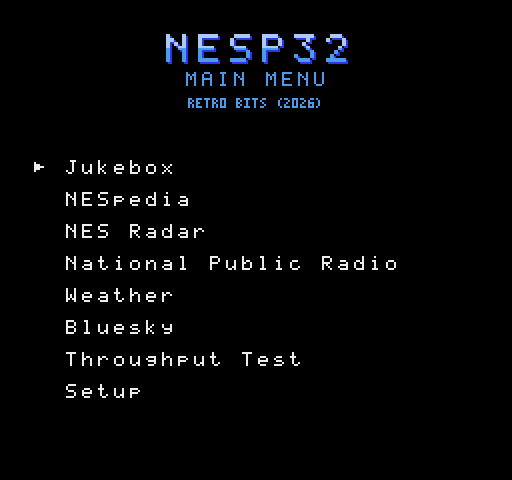

# Building and testing nesp32

What is in the repository, how to build it, what the tests cover, and how
far each part has got. The [README](../README.md) has what the nesp32 is,
and the steps for a first build.

## Building

For working on it, beyond the README's first build: a Python environment
for the tests, and the firmware's code built for this computer.

```sh
git submodule update --init    # for the two games and nes-radar only
python3 -m venv .venv && .venv/bin/pip install -r requirements-dev.txt
make            # build/setup.nes, and the firmware's code for this computer
make cart       # build/nesp32.nes: the cartridge (needs the nes-radar submodule)
make test       # about three and a half minutes
```

The nesp32's firmware is built with ESP-IDF, from `firmware/`
([its README](../firmware/README.md)). Each program in `apps/` has a
Makefile and a README of its own.

Four programs are other people's, and are not in this repository. Their
code is in submodules in `third_party/`. Three are games with netplay, from
disassemblies, and here is only what puts each on the link and the few
lines that call it, as patches, with each submodule kept at the commit the
patches were made for:
[nes-contra-us](https://github.com/vermiceli/nes-contra-us), vermiceli's,
for [nes-contra](../apps/contra),
[NES-Games-Disassembly](https://github.com/cyneprepou4uk/NES-Games-Disassembly),
cyneprepou4uk's, for [nes-drmario](../apps/drmario), and
[TetrisNESDisasm](https://github.com/CelestialAmber/TetrisNESDisasm),
CelestialAmber's, for [nes-tetris](../apps/tetris). Contra's build also needs a copy of the game, which whoever
builds it supplies. The fourth is [nes-radar](https://github.com/k6lcm/nes-radar),
k6lcm's, for [nes-radar](../apps/nes-radar), which from its 0.5.0 is for a
nesp32 and nothing else: its source has the link in it, and nothing here
patches it. The tests of the firmware's RADAR service run its 0.4.4
server's code beside the service, from a copy in `tests/fixtures`. None of
the games is on the cartridge; NES Radar is, so the cartridge's build needs
that submodule. Nothing else here needs any of the four.

### Changing a borrowed program's code

NES Radar's is changed in nes-radar itself, and the submodule moved to the
commit ([its README](../apps/nes-radar/README.md) has how). For the three
games, the build copies the submodule's sources into the program's
`build/` (`build/src` for Contra, `build/upstream` for Dr. Mario and
Tetris) and applies its `patches/` there; the submodule is never
written to. To change what nesp32 adds to their own files, edit the
copies, then

```sh
make patches    # patches/ again, from the copies
```

A patch is made with no context, so it holds our lines and where they go
and none of the original. That is why each submodule is kept at one commit
(`CONTRA_COMMIT`, `DRMARIO_COMMIT` and `TETRIS_COMMIT` in the Makefiles): the
patches are line numbers in that commit's files. `make clean` will not
delete copies that have changes `patches/` has not.

## The cartridge



One ROM with every program in the [README](../README.md)'s table but the
two games, and a menu that is up at power-on: Up and Down, and A or Start
to run a program. Reset is the menu again. Each program is built from its
own directory in `apps/`, with its own Makefile, into `build/cart/`.

### Buttons

Every program on the cartridge works the controller the same way:

| | |
|---|---|
| **A** | OK: choose, play, look up, type the key |
| **B** | back a step, from a deeper screen to the one before; on a keyboard, delete. Never out of the program |
| **Start** | start, or send what was typed where A and B are for typing |
| **Select** | the cartridge's menu, from any screen the program reads the controller on. Built by itself, a program has none, and Select does nothing |

B never leaves a program so that pressing it again and again, to get
out of a screen several steps in, stops at the program's first screen
instead of throwing away what was on the way there. A program's first
screen says `SELECT : MENU` at its foot on the cartridge, beside what A
does, written `A : PLAY`, a space either side of the colon and three
between one button and the next. Deeper screens say what B does. Setup
keeps its Quit, under its menu's other lines, and Bluesky its own short
help, `Sel:menu`, for want of room. NESpedia's reader is the one screen
where Select is not the menu: there it is back to the search, and A and B
page down and up through the article.

While sampled sound plays (the Jukebox, NESradio) only A can be read,
since the controller is read on the line the samples come in on: B and
Select work again once A has stopped or paused it.

It is an MMC1 (mapper 1) with 256 KB of PRG and 128 KB of CHR ROM and no
memory. Set to 32 KB of PRG and 8 KB of CHR, an MMC1 is an NROM to a
program that never writes to it, so the six programs that are each an NROM are
on it as they were built, their serial routines on the
pages they were timed on. `nes/cart/gen_cart.py` has where everything is
and the few bytes that are not as built: six in each program's padding and
its reset vector, which make reset the menu.

NES Radar is not an NROM: it has two pages of tiles, its
splash's and its scope's, and changes between them. By itself it is a
CN-ROM, whose latch is a write to the ROM, and on an MMC1 that write would
go to the mapper and move the banks from under it. So the cartridge has a
build of its own (`make cart` in [nes-radar](../apps/nes-radar)), which
asks the MMC1's CHR register for the page it wants, five writes, and is
told when it is built where its two pages are. It is the one program the
mapper hears from, and the tests hold it to that register and no other.

The menu is in the last bank, which is the one an MMC1 has at `$C000` when
the power comes on. Emulators do that, and most of the chips; one that did
not would not start this cartridge.

## How far each part has got

Each program's README has its own status, with the figures from hardware.
What is still to do on the hardware and the firmware is in
[TODO.md](TODO.md).

| Part | State |
|---|---|
| The protocol ([`PROTOCOL.md`](PROTOCOL.md)) | version 1: frames, short frames, hello, and the services SYS, NET, RAW, PEER, DIAG, KBD, JUKE, WIKI, RADAR, TUNER, WEATHER and BSKY |
| The link and services in C (`firmware/components/`) | done; tested on a computer |
| The console's library (`nes/lib/`) | done; every read and write timed on py65 |
| The firmware (`firmware/main/`): UART, Wi-Fi, HTTPS, the screen, the files, the USB drive, the connection to another nesp32 | working on a StickS3 and on a StickC Plus2, with the MiSTer and with a real NES ([its README](../firmware/README.md)) |
| The nesp32's files, in a FAT filing system, with rips converted on the nesp32 itself | working on hardware: written over USB with `tools/put_files.py` to a StickC Plus2, and copied to a StickS3 as a USB drive |
| A computer in place of a nesp32 (`host/serial_host.py`) | written, not run on a cable |
| The cartridge (`nes/cart/`): eight programs and a menu, on an MMC1 | working on hardware with the first five, a real NES and the MiSTer, with each board. NESradio, Weather and Bluesky start from the menu on a simulated console; the cartridge with them has not yet run on hardware |
| [Setup](../apps/setup), SYS, NET, DIAG | working on hardware |
| A Bluetooth keyboard: KBD, [Setup](../apps/setup)'s screen for it, [NESpedia](../apps/wiki)'s search and reader, and [Weather](../apps/weather)'s zip code; every program on the cartridge asks for KBD, to keep the keyboard connected, and takes its keys as the controller's buttons (NESradio's until its station plays) | working on hardware: a StickS3 with a Logitech MX Keys S, paired from Setup, typing NESpedia's searches and Weather's zip codes, and paging NESpedia's articles |
| [NESpedia](../apps/wiki), WIKI | working on hardware |
| [Jukebox](../apps/jukebox), JUKE and RAW | working on hardware |
| [Throughput](../apps/throughput), RAW | working on hardware |
| [Dr. Mario](../apps/drmario) and [Contra](../apps/contra), PEER | working on hardware, two consoles on one network |
| [Tetris](../apps/tetris), PEER | the game for two, finished, and a session, on two simulated consoles; not yet on hardware |
| [NES Radar](../apps/nes-radar), RADAR | working on hardware |
| [NESradio](../apps/npr), TUNER | working on hardware, and for long runs |
| [Weather](../apps/weather), WEATHER | working on hardware, the ROM by itself |
| [Bluesky](../apps/bluesky), BSKY | on a simulated console against the firmware's code; not yet on hardware |

## What is where

| Path | Purpose |
|---|---|
| `proto/nesp.toml`, `tools/gen_proto.py` | the numbers both ends share, and the C, ca65 and Python files written from them |
| `docs/` | the protocol, the wiring, this file, the hardware and firmware to-do list, and write-ups of bugs found on hardware |
| `firmware/components/nesp_core` | frames, CRC, services' registry |
| `firmware/components/nesp_services` | every service, the text code WIKI lays articles out with, and the MP3 decoder TUNER plays a station with |
| `firmware/main` | the board: UART and link task, Wi-Fi, HTTPS fetches, the connection to another nesp32, files, screen and buttons |
| `hardware/` | the hat's board, its parts and pictures |
| `web/` | the product page and the page that flashes a nesp32 from a browser (`make web`); `.github/workflows/web.yml` builds the firmware and the cartridge and puts the site on GitHub Pages whenever either changes on main |
| `tools/put_files.py` | puts the jukebox's tracks on a nesp32, over USB, for a board that cannot be a drive |
| `tools/lcd.py` | pictures of the nesp32's own screen, for trying a layout before flashing it |
| `nes/lib/nesp.inc`, `nes/lib/gen_link.py` | the console's library, and its cycle-timed serial routines |
| `apps/` | the programs, a directory each |
| `third_party/` | the two games' disassemblies and nes-radar, as submodules; and minimp3, the MP3 decoder (CC0), as a file |
| `nes/cart/` | the cartridge: its menu, and the tool that puts the programs on it |
| `host/nesp_host.c`, `host/nesp.py` | the firmware's code as a library for this computer, with a stand-in for the hardware |
| `host/serial_host.py` | that, on a USB serial cable in place of a nesp32 |
| `host/peer_net.py` | for it, PEER's connection to another nesp32 on this computer's sockets, and an opponent who never presses a button |
| `host/peer_player.py` | a second player with no second console: the other nesp32 and its console, for trying a netplay ROM on one NES, in a room at the real rendezvous or by address |
| `tests/console.py`, `tests/wire.py`, `tests/drive.py` | a console on py65, the serial line, and a hand on the controller |

## Tests

```sh
make test
```

- `test_core.py`: the C link and services, bytes in and bytes out.
- `test_link_timing.py`: every sample and every bit of the console's two
  receivers and its sender, at every phase and with the nesp32's clock out.
- `test_link.py`: the ROM and the C code over the line: how soon and how
  late the nesp32 may answer, damaged and lost frames, a nesp32 switched
  off and on.
- `test_text.py`, `test_wiki.py`: an API reply to ASCII to lines of 28, and
  the WIKI service with the test in place of the Internet.
- `test_raw.py`: a run agreed, called off, sent and heard, with the test as
  the clock and the UART, and then on the simulated line at its own rate.
- `test_juke.py`: the playlist as a stream whatever is lost on the way,
  the buttons, and a sound handed to RAW, with the test as the console.
  The jukebox's ROM itself is run against this code in nes-jukebox's tests.
- `test_peer.py`: the lobby, the greetings and the relay of buttons, with
  the test as the network between two nesp32s. Dr. Mario's netplay ROM is
  run against this code, on two consoles, in nes-drmario's tests.
- `test_peer_net.py`: a computer's stand-in for that network, on real
  sockets on this machine.
- `test_peer_player.py`: `host/peer_player.py` against a console of the
  test's: the digest sent back, and what player 2 does.
- `test_radar.py`: where an airport is from Wikidata's answer, a reply
  from adsb.fi to a scene and its names, held to the bytes nes-radar's own
  server makes of it and of 40 made up, and the fetches by the clock, with
  the test as both sites. nes-radar's ROM is run against this code in
  nes-radar's tests.
- `test_tuner.py`: a station's stream, an MP3 of a tone, to the tone on
  the line as the console's DAC would have it; a ring that fills and one
  that runs dry; and every way the sound ends. NPR's ROM is run against
  this code in its own tests.
- `test_weather.py`: a zip code to a place and the place's weather to a
  report, from what Zippopotam and Open-Meteo sent for one; every weather
  code's picture; a zip code that does not exist told from a site that is
  down; and the fetches by the clock. Weather's ROM is run against this
  code in its own tests.
- `test_bsky.py`: an account's posts to cards, from what Bluesky sent for
  one; text as ASCII, wrapped and cut; ages and dates; posts offered as
  they come; handles; an account that does not exist told from a site
  that is down; and the favorites, kept. Bluesky's ROM is run against
  this code in its own tests.
- `test_put_files.py`: the image of the tracks that goes over USB.
- `test_vgm.py`: the converter of rips, held to the same bytes as
  nes-jukebox's Python over its rips, over made-up ones, and over 300 made
  at random.
- `test_setup.py`: every screen of the setup ROM worked with the
  controller, to a network joined with a password of every character.
- `test_cart.py`: the cartridge on a console with its mapper: every
  program on it as built, started from the menu, and left by reset, and
  NES Radar's tiles as it asks the mapper for them. It skips without the
  other programs in `apps/`, or without nes-radar in `third_party/`.

The ROM tests need cc65 and skip without it.
