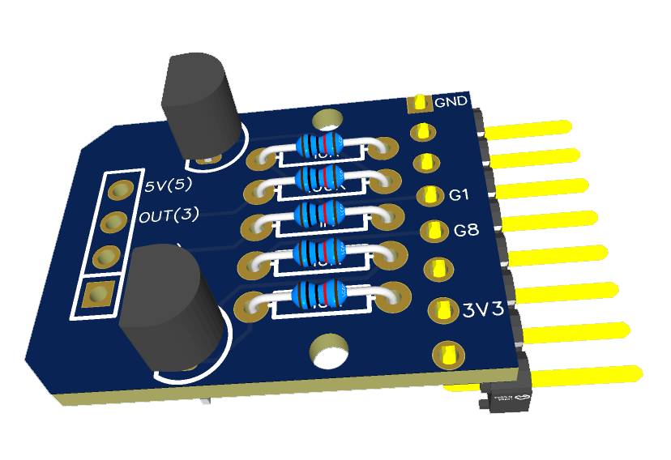
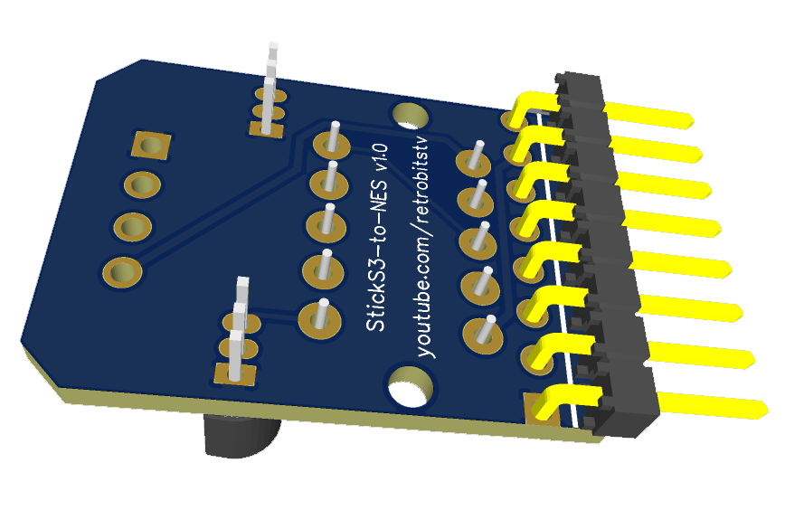

# NESP32 Hat
This PCB connects the M5 StickS3 to controller port 2 of the NES for bidirectional serial communication.

## Purpose
The StickS3 used by the NESP32 is already capable of serial communication on its GPIO header. The ESP32 uses 3.3V signalling while the NES uses 5V. This hat shifts the levels between both devices and is designed to fit in the footprint of the M5 Proto Hat's enclosure.

This hat is also compatible with the M5 StickC-Plus2 which is no longer available for purchase.

The circuit, the pins it uses on each Stick, and why the levels have to be shifted are in [docs/WIRING.md](../docs/WIRING.md).

## Specifications
* Base Material: FR-4
* Layers: 2
* PCB Thickness: 1.6mm
* Dimension: 26 x 19.7 mm
* Outer Copper Weight: 1 oz

## Bill of Materials
* 2 x 2N3904 Transistors
* 1 x 1K Axial-0.3 Resistor
* 3 x 10K Axial-0.3 Resistors
* 1 x 100k Axial-0.3 Resistor
* 1 x 8-pin 2.54mm 90 Degree Right Angle Single Row Male Pin Header (reverse) [Amazon](https://amzn.to/4e4FZ7i)
* 1 x NES Controller Pigtail [Amazon](https://amzn.to/4dVqi2r)

## Important Notes
* It is recommended to use additional flux when soldering in the transistors due to the small pads
* Make sure to orient the 8-pin connector as shown in the pictures (below)

 

RetroBits on YouTube - https://youtube.com/retrobitstv

