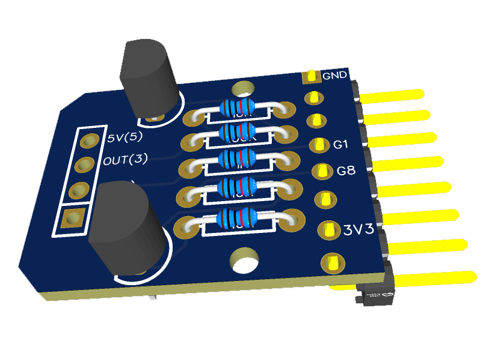
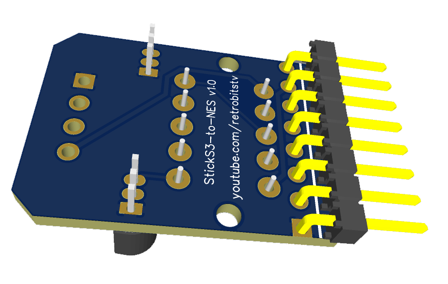

# NESP32 Hat
This PCB connects the M5 StickS3 (and StickC-Plus2) to controller port 2 of the NES for bidirectional serial communication.

## Purpose
The StickS3 used by the NESP32 is already capable of serial communication on its GPIO header. The ESP32 uses 3.3V signalling while the NES uses 5V. This hat shifts the levels between both devices and is designed to fit in the footprint of the M5 Proto Hat's enclosure.

This hat is also compatible with the M5 StickC-Plus2 which is no longer available for purchase.

The circuit, the pins it uses on each Stick, and why the levels have to be shifted are in [docs/WIRING.md](../docs/WIRING.md).

To build one step by step, with the checks to run before you plug it in, follow the [Build Guide](../docs/BUILD_GUIDE.md).

## Specifications
* Base Material: FR-4
* Layers: 2
* PCB Thickness: 1.6mm
* Dimension: 26 x 19.7 mm
* Outer Copper Weight: 1 oz

## Bill of Materials
* 2 x 2N3904 Transistors (see note below!)
* 1 x 1K Axial-0.3 Resistor
* 2 x 10K Axial-0.3 Resistors
* 1 x 3.3K Axial-0.3 Resistor (the TX pull-up, from NES +5V to the TX transistor's collector)
* 1 x 100k Axial-0.3 Resistor
* 2 x 100pF ±5% C0G/NP0 multilayer ceramic capacitors, radial through-hole, 2.5mm lead spacing, 50V or higher: TDK FA18NP02A101JNU00 ([LCSC C1632558](https://lcsc.com/product-detail/Multilayer-Ceramic-Capacitors-MLCC-Leaded_TDK-FA18NP02A101JNU00_C1632558.html), 100V), or FA18C0G1H101JNU00 ([LCSC C1621487](https://lcsc.com/product-detail/Multilayer-Ceramic-Capacitors-MLCC-Leaded_TDK-FA18C0G1H101JNU00_C1621487.html), 50V). Footprint: the part's own EasyEDA footprint, 2 pads at 2.5mm pitch. These are the speed-up capacitors, one across the TX transistor's 10K base resistor and one across the 100K RX base resistor. The current board has no holes for them; until the next revision, solder each across its resistor's leads (see the [Build Guide](../docs/BUILD_GUIDE.md))
* 1 x 8-pin 2.54mm 90 Degree Right Angle Single Row Male Pin Header (reverse) [Amazon](https://amzn.to/4e4FZ7i)
* 1 x NES Controller Pigtail [Amazon](https://amzn.to/4dVqi2r)

## Important Notes
* Fit both 100pF speed-up capacitors. With them, both high quality 2N3904s from a vendor such as Digikey or Mouser and inexpensive bulk ones reach the link's fastest rate, 298296 baud, in both directions. Without them, slow bulk transistors (relabeled general-purpose or audio parts) lower the maximum throughput, and every hat stops at 223722 baud from the console.
* It is recommended to use additional flux when soldering in the transistors due to the small pads
* Make sure to orient the 8-pin connector as shown in the pictures (below)

 

RetroBits on YouTube - https://youtube.com/retrobitstv

