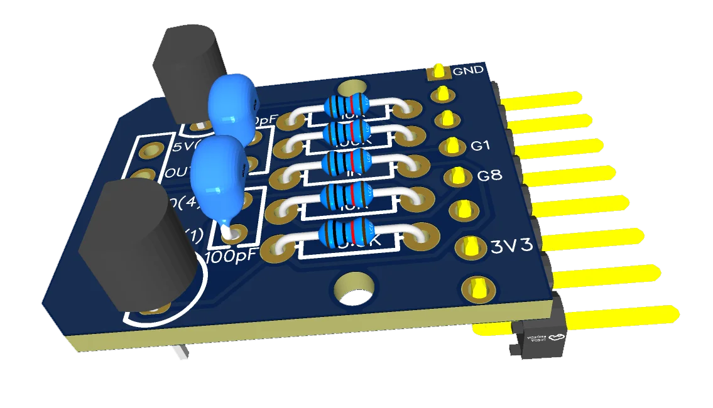
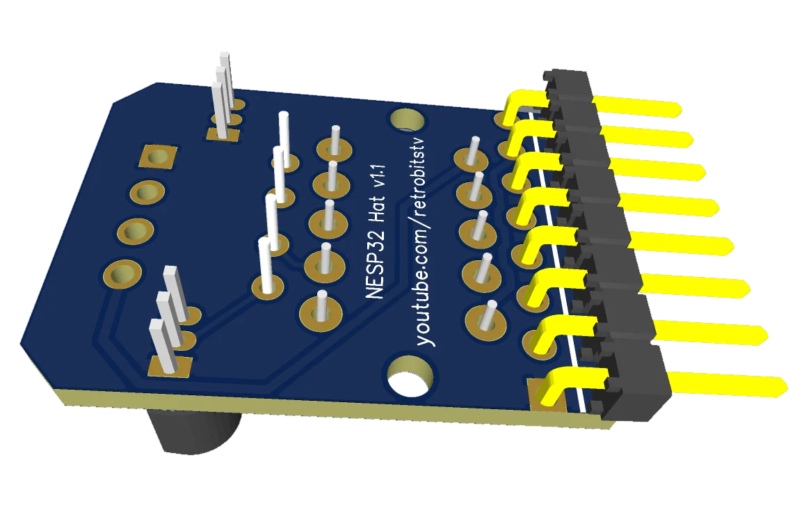

# NESP32 Hat
This PCB connects the M5 StickS3 (and StickC-Plus2) to controller port 2 of the NES for bidirectional serial communication.

## Purpose
The StickS3 used by the NESP32 is already capable of serial communication on its GPIO header. The ESP32 uses 3.3V signalling while the NES uses 5V. This hat shifts the levels between both devices and is designed to fit in the footprint of the M5 Proto Hat's enclosure.

This hat is also compatible with the M5 StickC-Plus2 which is no longer available for purchase.

The circuit, the pins it uses on each Stick, and why the levels have to be shifted are in [docs/WIRING.md](../docs/WIRING.md).

To build one step by step, with the checks to run before you plug it in, follow the [Build Guide](../docs/BUILD_GUIDE.md).

## Specifications
* Base Material: FR-4
* Layers: 2
* PCB Thickness: 1.6mm
* Dimension: 26 x 19.7 mm
* Outer Copper Weight: 1 oz

## Bill of Materials

| Qty | Part | Notes |
|---:|---|---|
| 1 | NESP32 hat PCB | Download the Gerber file here or [order from PCBWay](https://www.pcbway.com/project/shareproject/NESP32_Hat_for_M5_StickS3_d23db4e5.html) |
| 2 | 2N3904 NPN transistors | See note below |
| 1 | 1 kΩ resistor | Axial-0.3 |
| 2 | 10 kΩ resistors | Axial-0.3 |
| 1 | 3.3 kΩ resistor | Axial-0.3 |
| 1 | 100 kΩ resistor | Axial-0.3 |
| 2 | 100 pF ceramic capacitors | ±5% C0G/NP0, 50 V, radial 2.5mm lead spacing, optional - see note below |
| 1 | 8-pin header | 2.54mm 90 Degree Right Angle Single Row Male Pin Header (reverse) [Amazon](https://amzn.to/4e4FZ7i) |
| 1 | NES controller pigtail | or a controller extension cable cut such as [Amazon](https://amzn.to/4dVqi2r) |

## Important Notes
* It is recommended to use additional flux when soldering in the transistors due to the small pads
* Make sure to orient the 8-pin connector as shown in the pictures (below)
* The two optional 100pF speed-up capacitors allow cheap/bulk 2N3904 transistors from Amazon/Aliexpress to reach the fastest link speeds. High quality parts from vendors such as Digikey or Mouser don't need them

 

RetroBits on YouTube - https://youtube.com/retrobitstv

