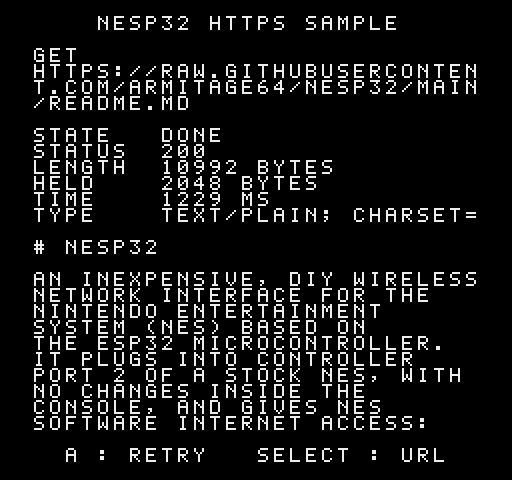

# HTTPS: fetch an address and show what came back



A sample ROM for a console with a nesp32 on controller port 2. It asks
the nesp32 to fetch an address from the Internet with the **HTTP**
service, and shows the reply as it came:
- the server's status code;
- the `Content-Length`;
- how much of the body the nesp32 holds;
- how long the fetch took;
- the `Content-Type`;
- the start of the body, as text wrapped to the screen.

The address is this repository's `README.md` on GitHub, as raw text. The
nesp32 does all the TLS and HTTP work; the console only names the address
and reads the result.

| Button | What it does |
|---|---|
| A or Start | fetch the address again |
| Select | switch to the other address: a file that isn't there, for a `404` |
| Down | the next screenful of the body |
| Up | the first screenful again |

## Building and running

```sh
make -C samplecode/https          # samplecode/https/build/https.nes
make -C samplecode/https test     # the ROM against the nesp32's firmware, simulated
```

It needs cc65 and Python 3, and for the tests `pytest` and `py65` from the
top level's `requirements-dev.txt`. On hardware the nesp32 needs firmware
with the HTTP service (`firmware/deploy.sh`) and a Wi-Fi network, which
the setup ROM joins. With older firmware the screen says `UPDATE NESP32`.

## What crosses the link

| When | Request | Reply |
|---|---|---|
| At reset, and whenever the nesp32 says HTTP isn't in use | `SYS HELLO`: `HTTP`, version 1, asking for the HTTP service | the firmware's version, and whether it has HTTP |
| Once per address | `HTTP URL`, in pieces of up to 60 characters: where in the address the piece goes, then the piece | the fetch's state |
| To start a fetch | `HTTP GET` with an id. A new id is a new fetch, so the ROM can send the same GET until it gets an answer | the fetch's state |
| A few times a second until the fetch is over | `HTTP STATE` | state, status code, length, bytes held, milliseconds, and the type (or why it failed) |
| As the screen needs text | `HTTP READ`: an offset, and 60 bytes | the body's bytes from that offset |

The service is documented in [`docs/PROTOCOL.md`](../../docs/PROTOCOL.md),
"HTTP `$07`". In short:

- **Every status is a reply.** A `404`'s body is held just like a `200`'s,
  and the screen shows both.
- **The nesp32 holds only the first 2 KB of the body** and doesn't read
  the rest. `LENGTH` is still the server's whole `Content-Length`; this
  README is about 11 KB.
- **The server's certificate is checked** against ESP-IDF's bundle of root
  certificates, and redirects are followed, up to five.
- **The body arrives as raw bytes.** Making text of them is the ROM's job.
  This one wraps at the last space before 28 columns, ends a line at LF,
  ignores CR, and shows any byte outside printable ASCII as `?`. The font
  shows lowercase as capitals.

## How the ROM is built

Everything is in [`nes/https.s`](nes/https.s); the top comment is a tour.

- **Exchanges happen in the main loop**, one per frame, right after the
  NMI. That's the simpler way to use the link, and the common one. A reply
  of 60 bytes takes about a third of a frame. If the NMI falls in the middle
  of an exchange, it ends it (`nesp_nmi_hook`), and the main loop asks
  again on the next frame. The [lobby sample](../lobby) has to keep its
  exchanges in step with the frames, so it makes them inside the NMI
  instead.
- **The link has phases** (hello, URL, GET, then STATE and READ), and each
  frame's one exchange is the one its phase calls for. If 8 requests in a
  row get no reply, the screen says `NO NESP32`.
- **The NMI draws one row of 28 characters per frame**, staged by the main
  loop: the status lines whose values changed, then the body's rows.
- **The body is laid out as it's read.** The ROM keeps only one 60-byte
  READ's worth of it, plus the line being built. It asks for more only when
  the screen needs it, so the console never holds the whole body. For
  Down, it remembers where the first line that didn't fit began.

## Putting it in your own ROM

1. Say hello asking for `NESP_SVC_HTTP` (and any other services you need).
2. Send the address with `HTTP URL`, then `HTTP GET` with a new id.
3. Poll `HTTP STATE` until it's `DONE` or `FAILED`, and check `STATUS`.
4. `HTTP READ` the body in pieces, and parse it as it comes, since 2 KB of
   console RAM won't hold much of it. If the reply is JSON or HTML and the
   ROM only wants a little of it, a service of the nesp32's own that lays
   the answer out (like WEATHER or WIKI) is the better tool. HTTP is for
   replies that are already short and simple.

## Sizes

About 2.6 KB of code and data, 512 bytes for the CRC's table, the serial
routines on two pages of their own, and about 360 bytes of RAM.
