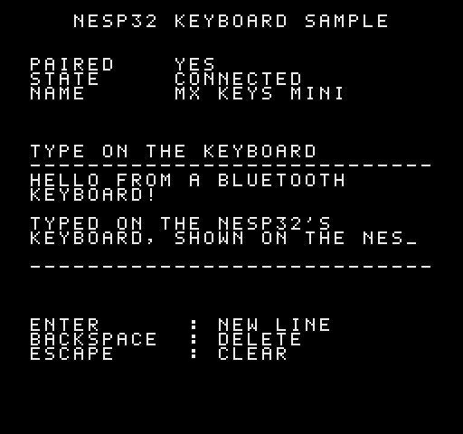

# Keyboard: text from a Bluetooth keyboard



A sample ROM for a console with a nesp32 on controller port 2 and a
Bluetooth keyboard paired with the nesp32. It shows:
- whether a keyboard is paired;
- how the keyboard stands (connected, asleep, not paired, and so on);
- the keyboard's name;
- a text field of 6 lines of 28 characters that takes whatever is typed.

| Key | What it does |
|---|---|
| any printable key | types it at the cursor; a full line goes on to the next |
| Enter | starts a new line |
| Backspace | deletes the last character; at the start of a line, goes back to the end of the one before |
| Escape | clears the field |

The keyboard is paired with the **nesp32**, not the console. The nesp32
remembers it over power-off, connects to it, and turns key presses into
characters (US layout), so the ROM only ever hears characters. Pairing is
done in the setup ROM's KEYBOARD screen. This sample leaves out the pairing
ops (SCAN, FOUND, PAIR); [`apps/setup/nes/kbd.inc`](../../apps/setup/nes/kbd.inc)
shows them.

Only the StickS3 has Bluetooth. On a StickC Plus2 the screen says
`NO BLUETOOTH`.

## Building and running

```sh
make -C samplecode/keyboard          # samplecode/keyboard/build/keyboard.nes
make -C samplecode/keyboard test     # the ROM against the nesp32's firmware, simulated
```

It needs cc65 and Python 3, and for the tests `pytest` and `py65` from the
top level's `requirements-dev.txt`.

## What crosses the link

| When | Request | Reply |
|---|---|---|
| At reset, and whenever the nesp32 says KBD isn't in use | `SYS HELLO`: `KEYS`, version 1, asking for KBD. That turns Bluetooth on | whether the firmware has KBD |
| Twice a second | `KBD STATE` | the keyboard's state, and the name of the one paired |
| Every other frame | `KBD KEYS` | up to 16 characters typed since the last KEYS, oldest first |
| When a KEYS reply was lost | the **same** KEYS request again (`nesp_again`) | the reply the nesp32 held, with the same characters |

The service is documented in [`docs/PROTOCOL.md`](../../docs/PROTOCOL.md),
"KBD `$06`". A character is printable ASCII (`$20`–`$7E`) or one of a few
keys that aren't, such as `$08` Backspace, `$0A` Enter, `$1B` Escape and
the arrows. This sample ignores the arrows.

**Don't lose keys.** KEYS takes the characters off the nesp32 as it hands
them over, so a reply that never arrives would lose them. The nesp32 holds
the last reply of each service, though, and answers a request repeated
byte for byte (same sequence number) with that held reply. So when a KEYS
gets no reply, the ROM sends it again with `nesp_again`, before asking the
KBD service anything else. The test `test_a_lost_reply_loses_none_of_what_was_typed`
drops a reply on purpose and checks that nothing is lost or doubled.

## How the ROM is built

Everything is in [`nes/keyboard.s`](nes/keyboard.s); the top comment is a
tour.

- **Exchanges happen in the main loop**, one per frame, right after the
  NMI, as in the [HTTPS sample](../https). If the NMI falls in the middle
  of an exchange, it ends it (`nesp_nmi_hook`), and the ROM treats that as
  a lost reply.
- **The NMI draws two things:** a row of text when a status line changes,
  and the field's characters as they're typed, up to 16 single tiles a
  frame from a queue. A batch of KEYS longer than the queue goes in over
  the next frames, and the next KEYS waits until it has.
- **The cursor is a sprite** of the font's underscore, blinking every 16
  frames, and hidden once the field is full.

## Putting it in your own ROM

1. Ask for `NESP_SVC_KBD` in the hello. Bluetooth is on only while a ROM
   has KBD in use, and the keyboard stays connected from one ROM to the
   next if each one asks for it.
2. Ask `KBD KEYS` often (every frame or every other) and act on each
   character. Resend a KEYS whose reply was lost with `nesp_again` before
   anything else.
3. Ask `KBD STATE` now and then to show the keyboard's state, if your
   screen has room.
4. To also use the keyboard as controller 1, define `NESP_KEY_PAD` before
   including `nesp.inc`; `nesp_key_pad` turns the arrows, Enter and Escape
   into buttons, as every program on nesp32's cartridge does.

## Sizes

About 1.8 KB of code and data, 512 bytes for the CRC's table, the serial
routines on two pages of their own, a page for the sprites, and about 210
bytes of RAM.
