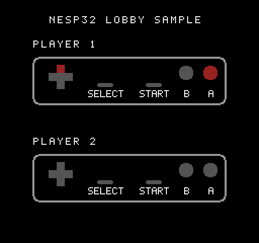

# Lobby: a two-player game over the network, as small as it gets



A sample ROM for two consoles, each with a nesp32 on controller port 2. It
boots to the same lobby as nesp32's netplay games (Dr. Mario, Tetris,
Contra, TMNT II). Once the two consoles are joined, each one shows both
players' controllers and lights every button that's down, on both screens
at the same tick.

The controller display is the whole "game". Everything around it is what
your own game would keep: the hello, the lobby, and a session in lockstep
with the delay report and the digest check. It is meant to be read, run,
and copied into a game of your own.

## Building and running

```sh
make -C samplecode/lobby          # samplecode/lobby/build/lobby.nes
make -C samplecode/lobby test     # two simulated consoles, each with a nesp32
make -C samplecode/lobby preview  # docs/screen.png
```

It needs cc65 (`ca65` and `ld65`) and Python 3. The tests also need
`pytest` and `py65`, from the top level's `requirements-dev.txt`. The
build takes the protocol's numbers and the console's library from this
checkout, two directories up, so the sample isn't built on its own.

On hardware: put `lobby.nes` on a flashcart in each console, with a
nesp32 that has joined Wi-Fi (the setup ROM does that once). On one
console choose **HOST GAME** and read off the room's code. On the other
choose **JOIN GAME**, enter the code (Left/Right moves, Up/Down changes a
letter) and press Start. **Select** on either screen switches to meeting by
IP address, which is for two consoles on one network with no Internet.
**B** goes back.

## The files

| File | What it is | Keep it in your game? |
|---|---|---|
| [`nes/lobby.s`](nes/lobby.s) | Reset, the NMI, the main loop, reading the controller, drawing a screen. Its top comment walks through everything that crosses the link | The NMI's order (PPU first, then the one exchange) and `read_pad`'s way with OUT0 |
| [`nes/menu.inc`](nes/menu.inc) | The lobby: the hello, and PEER's lobby ops until the two nesp32s are joined | All of it, restyled |
| [`nes/session.inc`](nes/session.inc) | The session: rings of buttons, the TICKS exchange, stalls, and ending | All of it. Two parts are marked `OPTIONAL` |
| [`nes/pads.inc`](nes/pads.inc) | The game: both players' buttons as sprites | No: this is where yours goes |
| [`tools/gen_chr.py`](tools/gen_chr.py) | The tiles, the session screen, and where each button's sprites go | No |
| [`tests/test_lobby.py`](tests/test_lobby.py) | Two consoles on the ROM, each with a nesp32's firmware, on a simulated network | Its `Network` and `Table` are a start for your own tests |

## How it works

### Every exchange is made in the NMI

The link is a serial line on controller port 2, and nesp32's library for
the console (`nes/lib/nesp.inc`) times it by counting CPU cycles, so
nothing may interrupt an exchange. This ROM makes **every exchange inside
its NMI**, after the NMI's writes to the PPU, one a frame at most. That's
how the netplay games do it, and it's the only way a session's exchange
can be tied to the frame. Since no other NMI can end a wait made inside
one, the library is built with the receiver that gives up by counting
(`gen_link.py --timeout`, `NESP_TIMEOUT`, `NESP_NMI_ONLY`).

The main loop decides what to ask for and stages it; the NMI makes the
exchange; the main loop reads the reply on the next frame. The main loop
writes to the PPU only with the picture and the NMI off, which is safe
because no exchange can be under way at that point.

### The lobby

From power on, the ROM says **SYS HELLO** as `PADS`, version 1, asking
for the PEER service. A nesp32 joins two consoles only if both said the
same name and version, so a game changes its version whenever what
crosses between the consoles changes.

After the hello, everything is PEER's lobby ([`docs/PROTOCOL.md`](../../docs/PROTOCOL.md),
"PEER"):

| What the player does | What the ROM sends | What it waits for |
|---|---|---|
| Nothing (the first screen) | `STATUS` every 16 frames | The nesp32's address, or `NO_WIFI` |
| HOST GAME, by room code | `HOST_ROOM`, then `ROOM` every 16 frames | The room's code, then `HOST`: this console is player 1 |
| JOIN GAME, by room code | `JOIN_ROOM` with the code, then `ROOM` | `GUEST`: this console is player 2. Or `FAILED` and why |
| HOST GAME, by address | `HOST`, then `STATUS` | `HOST` |
| JOIN GAME, by address | `LAST` (to start the edit from), then `JOIN` with the address | `GUEST`, or `FAILED` |
| B | `LEAVE` | |

Two rules keep this simple and robust:

- **An order is sent again until it is answered.** An order the nesp32 is
  already carrying out changes nothing, so sending one twice is harmless.
- **The ROM acts on a state only after the order that leads to it has been
  answered.** Until then a `STATUS` may still describe the state before.

If the nesp32 says PEER isn't in use, it was switched off and on, and the
ROM says hello again and repeats the order its screen is waiting on. If 8
requests in a row go unanswered, the screen says `NO NESP32`.

### The session

When the nesp32 says `HOST` or `GUEST`, the lobby starts a session
(`start_session`). Both consoles run the whole game and only buttons cross
the link, one byte per tick each way. A console takes a tick only when it
holds both players' buttons for that tick, so both games see the same
buttons at the same tick and stay the same game without anything else
being sent.

A console uses its own buttons `net_delay` ticks after reading them. That
gives them time to reach the other console. Each NMI is one of three
things:

| | When | What happens |
|---|---|---|
| a tick | the main loop is waiting, and both players' buttons are here | `game_buttons` gets them; the main loop runs `game_tick` |
| a stall | the main loop is waiting, but the other's buttons aren't here yet | the exchange is made; the picture stands |
| a lag | the main loop is still busy with the last tick | nothing (this sample never lags) |

The exchange is PEER's **TICKS as a short frame**: five or six bytes out,
four back. It carries up to two ticks of this console's buttons, plus the
tick of the other console's that it needs next, and the reply carries one
tick of the other's. Ticks start at −5 on both consoles, so whatever each
console's delay, both start reading at the right point.

Two parts are **optional**, and marked `OPTIONAL` in `session.inc`:

- **The delay report.** One exchange in 128 carries this console's report,
  and the reply carries the delay the nesp32 advises from how long the
  network has been taking. Without it, a console keeps the delay it began
  with: on a slow network it stalls often, and on a fast one presses feel
  late.
- **The digest.** One tick in 256 carries a digest of the game state in
  place of buttons. If the two digests differ, both consoles end the
  session. Without it, a bug that splits the two games goes unnoticed.
  This sample's game can't split, so here the digest never fires. Point it
  at your own game's state.

A session ends when the nesp32 says the other console is gone, when 240
NMIs in a row haven't been ticks, or when the digests differ. The lobby
then shows why (`THE OTHER LEFT`, `THE LINK FAILED`, `GAMES DIFFERED`) and
says hello again, which hangs up the nesp32's side as well.

## Putting it in your own game

1. Copy `nes/`, `tools/` and the Makefile. Change `NESP_APP` to four
   characters of your own, and pick your own screens and font.
2. Replace `nes/pads.inc` with your game. It runs once per tick from the
   main loop, and its only input is `game_buttons`: player 1's and player
   2's. It must depend on nothing else: not the frame count, not which
   console it's on, and not memory the session didn't set.
3. Put your game's state between `game_state` and `GAME_STATE` in
   `session.inc`, or point `session_digest` at it.
4. Keep the NMI's order: PPU writes first, then `session_nmi`. A game
   whose frames are already full should know the exchange costs about
   3,100 cycles, a tenth of a frame ([`docs/MULTIPLAYER.md`](../../docs/MULTIPLAYER.md),
   "What it costs a frame").
5. If the game plays DPCM samples, read the controller twice and compare,
   as a real NES can spoil a read: [`docs/PHANTOM-RIGHT.md`](../../docs/PHANTOM-RIGHT.md).

How a game that already exists is put on the link, through patches to its
disassembly, is in the netplay games: [Dr. Mario](../../apps/drmario) is
the plainest of them.

## Sizes

About 3.5 KB of code, 2 KB of data (most of it the session screen's
nametable and the CRC's table), the serial routines on two pages of their
own, and under 200 bytes of RAM, plus a page for the sprites.
